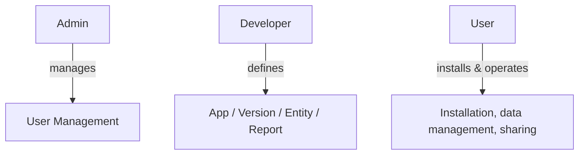
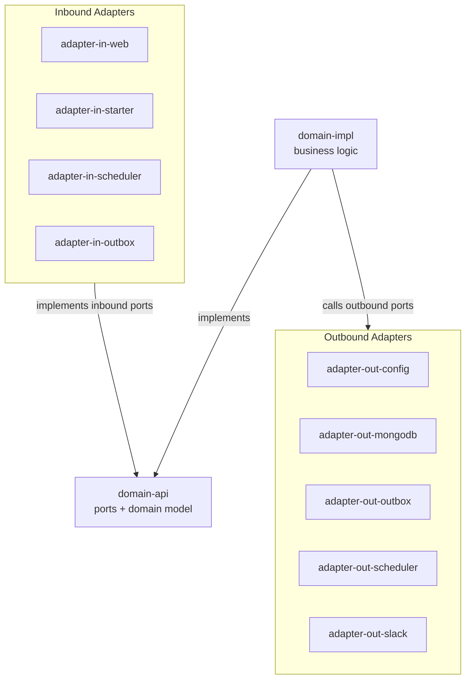
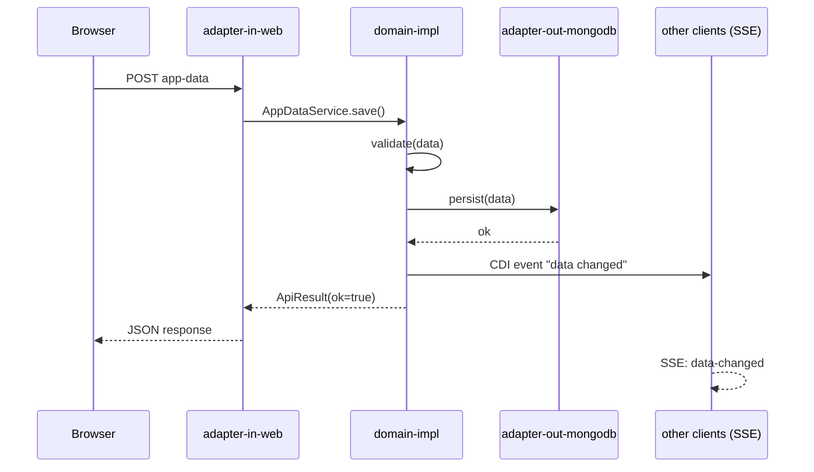
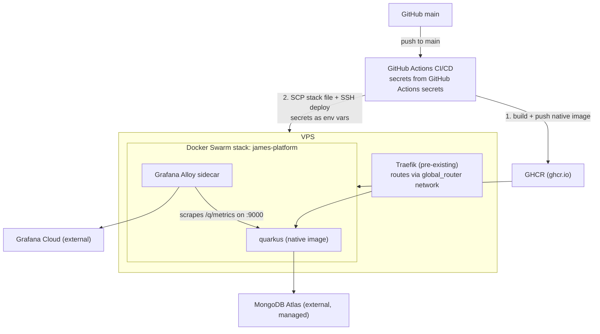

# james-platform

# Introduction and Goals

## Requirements Overview

James Platform is a personal Low Code system for building and running data-centric apps without writing boilerplate infrastructure code.

### Roles

| Role       | Description                                                                                         |
|------------|-----------------------------------------------------------------------------------------------------|
| Admin      | Platform administrator. Manages users. Cannot be a User or Developer at the same time.             |
| Developer  | Creates and maintains Apps. Defines entities, properties, and reports.                              |
| User       | Installs and uses App Versions. Enters, edits, deletes, and views data through the generic UI.     |
| Monitoring | Access to the Tools menu (health, config, logs, metrics, MongoDB viewer). Can be combined with other roles. |
| Data Import | Grants access to the per-app Data Import (ETL) feature. Assignable only by an Admin; typically combined with the User role. |

### User Management

- Self-registration is not supported; only an Admin can register new accounts.
- An Admin can: register users, delete accounts, block/unblock accounts, reset passwords.
- Every account has a unique username, a bcrypt password hash, and one or more roles.

### Apps and Versions

- A Developer creates an **App** and publishes it as a series of **Versions**.
- Each Version carries a **semver** number derived automatically from entity changes:
  - *Breaking change* (removed/renamed entity or property, changed immutable ID, changed unit family or storage granularity on a `long`/`Double` property) → mandatory **Major** release.
  - *Non-breaking change* → Developer chooses between **Feature** or **Bugfix** release.
  - The version number is never entered manually.
- A released Version records a release date and release notes.
- A Developer can attach declarative **migration steps** to an Entity, transforming existing `AppData` when an installation upgrades past that Version (Kotlin
  migration scripts were removed with ADR [0029](../adr/0029-expression-language-instead-of-kotlin-scripting.md)). Migration steps cover the most common changes: **Convert
  type** (a Property's type changed in place), **Copy value** (a Property was deleted and replaced by a new one, e.g. to change a `long`/`Double` Property's immutable
  storage granularity, see [Property Units](#property-units)), **Convert unit** (a Property gained a unit, or had its storage granularity changed in place — converting
  the existing value from a Developer-declared source granularity), **Fill empty value** (a Property changed from nullable to non-nullable — filling `null`/blank values
  with a fixed value or the Property's own default), and **Adjust to constraints** (a Property gained a more restrictive constraint — clamping out-of-range
  numeric/date/time values, or truncating over-long `String` values). Convert type/value/unit convert the value automatically if the source/target type or unit differ;
  Fill empty value/Adjust to constraints deliberately never fall back to `null` — a value they cannot fill/adjust fails the migration instead. Steps run in the order
  they are defined. A migration that provably brings all existing data into a valid state (checked via a dry-run at publish
  time) can neutralize what would otherwise be a breaking change, avoiding a mandatory Major bump. The version editor's Migration section proposes a matching migration
  step for every detected breaking Property change not yet covered by one (e.g. a type change, a tightened constraint, or a removed/added Property pair), pre-filled and
  ready to create with one click. The dry-run also accounts for installations whose auto-upgrade fell behind, applying their own pending migrations first rather than
  assuming every installation is already on the latest published Version. Migrations run synchronously as part of the upgrade (auto-upgrade for non-breaking Versions, or
  explicit User-triggered upgrade for breaking ones) — see ADR [0018](../adr/0018-app-version-migration-execution-trigger.md) and ADR
  [0023](../adr/0023-migration-steps.md). Steps belong to the Version they were authored on: a new draft starts without them, so they never re-run on a
  later upgrade. Publishing a non-breaking Version auto-upgrades every non-test installation of the same major that is not on it yet (also ones that fell behind,
  migrating across every skipped Version); dashboard, App page and App store page show such an upgrade as in progress, and offer the upgrade button only for a
  breaking (new major) Version. The Migration section also offers an interactive preview, analogous to the Data Import Mapping step's live preview: it applies
  the draft's already-saved migration steps to one existing `AppData` object at a time (a bounded sample across the App's installations) and shows the
  before/after value per Property plus any validation issues found while re-validating the result — without running a real dry-run or publish — with Prev/Next
  navigation across the sampled objects. See ADR [0015](../adr/0015-import-object-preview-endpoint.md).

### Entities and Properties

- A Version defines **Entities** and **Reports**.
- `List` values of dates, date-times, times and numbers are stored and shown ascending (e.g. the holidays of a configuration); other lists (texts,
  references, yes/no, objects) keep the order their items were entered in.
- An Entity has:
  - A name unique within the App.
  - A globally unique internal ID (immutable).
  - An ordered list of **Properties**.
  - An optional **display text template** – a string that interpolates property values (e.g. `{firstName} {lastName}`) into a human-readable label shown for each object in list views and `ref` pickers, instead of a raw ID.
    Values are formatted for display (dates `dd.MM.yyyy`, German number separators, unit properties as e.g. `10km 234m`); a `ref` placeholder shows the
    referenced object's own display text (up to two reference levels deep, e.g. meter reading → meter → home), falling back to its id.
- A Property has:
  - A name unique within the Entity (mutable).
  - An ID unique within the Entity (immutable).
  - A data type and associated constraints.
  - An optional static **default** value, and/or a **smart default** (see below).
  - For `long`/`Double` properties: an optional **unit** (see [Property Units](#property-units)).
  - Optional **value proposals** – a Developer-configured list of suggested values offered to the User as autocomplete options in the create/edit form.
  - For top-level `ref` properties: an optional **reference lookup** – the reference is entered as the text of a `String` property of its target Entity
    (which must be that Entity's only `UNIQUE KEY`), with the existing values as proposals and resolved to the target object on save. With
    **auto-create**, an unknown text creates a new target object together with the referencing object on save; the target's further properties are
    asked for inline in the form (see ADR [0026](../adr/0026-reference-lookup.md)).
  - For `object` properties: a nested list of Properties, which may themselves be `object` properties (arbitrary nesting depth).
  - For `List` properties: an item type (any type except `List`) and, optionally, item-level constraints.
  - A **`List` of `object`s** (item type `object`) carries the fields of its items as nested Properties, like an `object` Property, e.g. the sessions of
    a swimming day `sessions = [{bahnlänge, bahnen}]`. It is only allowed as a top-level Property, and its item fields only as simple values (`long`,
    `Double`, `boolean`, `String`, `date`, `time`, `datetime`; no `ref`, `List` or `object` - `OBJECT_LIST_NOT_SUPPORTED`). Every item field has its own
    constraints, default and unit; on save each item's units are converted and its required fields checked, items whose fields are all empty are
    dropped, and the list's own `min`/`max` size applies to the items. Stored as the list encoding of the items' JSON objects (by field id); the token
    API reads and writes it as an array of objects. The form renders one group of fields per item with add/remove (a new item starts with the
    fields' defaults; a create form starts with one item), display texts show it as `25m, 40 | 50m, 20`.
- **Computed properties** – a Developer may define derived properties by an **expression** of the platform's expression language (see
  [Reports](#reports), "Expression language"; ADR [0029](../adr/0029-expression-language-instead-of-kotlin-scripting.md)) with a result type (`long`,
  `Double`, `String`, `boolean`, `date`, `time`, `datetime`) and, for numbers, an optional unit (a granularity such as `KILOMETERS`; the result is a raw
  value in that granularity, like a Property's value). Expressions read the object's fields by Property name (Properties nested in `object` Properties
  as `objekt.feld`, references as the referenced object's id, numbers with a unit as raw storage values), the computed properties defined *before*
  them (definition order is the evaluation order), `config.<field>`, `today()` and `now()`; e.g. `round(gewicht / (groesse / 100) ^ 2, 1)` or
  `if(art == 'Urlaub', 0, sollStunden)`, over the items of a `List` with the list functions, e.g. `sum_of(sessions, bahnlänge * bahnen)`. They are parsed and type checked on save (unknown field or function, wrong operand/argument type, result not
  fitting the type; `last`/`next_day` are not available), with a German error message, and evaluated purely in Kotlin whenever an object is shown or
  read by a report - an expression without value (missing field, division by zero, a field renamed after saving) yields no value.
  Computed properties are shown on the object's edit page and are fields of reports.
- **App configuration** – an Entity may be marked as the Version's **configuration** (`EntityDefinition.configuration`, at most one per Version, no REF
  may target it, every required property needs a default): a singleton with exactly one object per installation, created from the defaults on install,
  test installation and upgrade (also onto the Version introducing it) and migrated like any data. The User edits it under "Einstellungen"
  (`/ui/user/apps/{installedAppId}/settings`, the generic edit form) but cannot delete it or create a second one; it is no data tile/list, not counted on
  the dashboard and no import or test data target. Reports, computed properties and smart defaults read it as `config.<field>`. Rule of thumb: settings without a time dimension go into the configuration, "valid from" values into a data Entity - see ADR
  [0027](../adr/0027-app-configuration.md).
- **Smart defaults** – like a static default, but an **expression** (ADR [0029](../adr/0029-expression-language-instead-of-kotlin-scripting.md))
  evaluated when the create form is opened, for top-level Properties (also `ref` Properties, which have no static default). Smart defaults are
  evaluated in Property order and read the static defaults, the smart defaults before them, `config.<field>`, `today()`, `now()` (current minute) and -
  only here - the Entity's **latest existing object**: `last(feld)` is the field's value there (e.g. the last used shoes `last(schuhe)`),
  `next_day(feld)` the day after it (e.g. `coalesce(next_day(datum), today())`). The latest object is the one with the latest time field (the first
  `date`/`datetime` Property the Entity is sorted by, else its first `date`/`datetime` Property), then the newest created. Further functions for data
  entry: `add_days(d, n)`, `end_of_month(d)` and `workdays(von, bis[, feiertage])` (Mondays to Fridays, both inclusive, without the given dates, e.g. a
  configuration `List` of dates: `workdays(start, ende, config.feiertage)`). A smart default that reads other fields of the form is **re-evaluated**
  when one of them changes (`POST /ui/user/apps/{installedAppId}/data/defaults` with the values entered so far), unless the User changed that field
  himself - e.g. Urlaub `ende = start`, `tage = workdays(start, ende, config.feiertage)`. Unlike computed properties, a smart default is only a
  starting value — the User may freely overwrite it, and it is not evaluated again after saving. The developer UI offers predefined smart defaults
  (today, the day after the last entry, end of month, now, last used value). Smart defaults are validated on save like computed properties.
- **Kotlin scripts stored before ADR 0029** (computed properties, smart defaults) still load, but are never evaluated: the version editor shows them as
  "Kotlin (ungültig)" with the script, and they are dropped once an expression is saved (or the value cleared). Stored migration scripts are ignored.

### Supported Data Types

| Type       | Description                                                                                           |
|------------|-------------------------------------------------------------------------------------------------------|
| `long`     | 64-bit integer                                                                                        |
| `Double`   | 64-bit floating-point                                                                                 |
| `boolean`  | True/false                                                                                            |
| `String`   | Text                                                                                                  |
| `date`     | Calendar date                                                                                         |
| `time`     | Time of day                                                                                           |
| `datetime` | Combined date and time                                                                                |
| `ref`      | Reference to an object of the same or another Entity within the same App Version                      |
| `List`     | Ordered list of any type except `List` (a list of `object`s: repeatable groups of simple fields)     |
| `object`   | Inline nested object with its own property list (analogous to an anonymous Entity without a global ID) |

Cyclic reference graphs via `ref` are detected and rejected at schema-definition time.

> There used to be a standalone `duration` type, storing its textual input verbatim (e.g. `"1d 2h 30m 15s"`).
> It was replaced by `long` + `PropertyUnit(family = TIME)` and removed entirely, including a one-time
> migration of existing data (see ADR [0017](../adr/0017-duration-migration-and-removal.md)).

### Property Units

A `long`/`Double` property may carry a **`PropertyUnit`**, letting a Developer attach a unit family to a
numeric field and a User enter values as unit-suffixed text (e.g. `15km 400m`) instead of a bare number.

- A `PropertyUnit` has a **`family`** (`TIME`, `DISTANCE`, `CURRENCY`, `MASS`, `ENERGY` or `VOLUME`), a **`storageGranularity`**, and a
  **`defaultGranularity`** — both granularities are one of `TimeGranularity` (`MILLISECONDS`, `SECONDS`,
  `MINUTES`, `HOURS`, `DAYS`), `DistanceGranularity` (`MILLIMETERS`, `CENTIMETERS`, `METERS`,
  `KILOMETERS`), `CurrencyGranularity` (`CENTS`, `EUROS`), `MassGranularity` (`MILLIGRAMS`, `GRAMS`, `KILOGRAMS`),
  `EnergyGranularity` (`KILOJOULES`, `KILOCALORIES`, `WATT_HOURS`, `KILOWATT_HOURS`, exact via millijoules) or
  `VolumeGranularity` (`MILLILITERS`, `LITERS`, `CUBIC_METERS`), matching the unit's `family`.
- `TIME` and `DISTANCE` values are displayed as a composite over all granularities (`15km 400m`, `2d 7h 15min`); `MASS`, `ENERGY` and `VOLUME`
  values as a single amount in the storage granularity (`75,3kg`, `2300kcal`), since mixed granularities (`2kWh 300kcal`) do not read well.
- An optional **`maxDisplayGranularity`** caps the largest granularity of a composite (the storage granularity is the smallest): with `HOURS` a
  balance of 3315 minutes reads `55h 15min` instead of `2d 7h 15min`, a yearly sum `1241h` (negative values `-55h -15min`). It must belong to the
  unit's family and must not be finer than `storageGranularity`; without it all granularities are used, as before. It only affects display (every
  formatted unit value: object views, display texts, reports) and may change freely - no breaking change. It is set in the property editor
  ("Größte Anzeige-Einheit"), for properties, nested properties and computed properties (`maxUnit`), and via the token API
  (`PUT …/properties/{propertyId}/unit` with `maxDisplayGranularity`, computed properties with `maxUnit`); report `calc` steps take `maxUnit`.
- `CURRENCY` always means euros: there is no currency code and no exchange-rate conversion. Unlike the other
  families, a currency value is displayed as a single euro amount with two decimals (`12,50€`) rather than
  as a composite (`12€ 50ct`).
- Values are always stored numerically in `storageGranularity` — `UnitFormat` parses a User's textual
  input (e.g. `"15km 400m"` → `15400` at `storageGranularity = METERS`) at write time (see ADR
  [0016](../adr/0016-property-units-storage-granularity.md)). For a `long` property, the converted value
  must be an integer (a fractional result is rejected).
- Adding a unit to a previously unit-less field is a breaking change that a **Convert unit** migration step
  (see ADR [0023](../adr/0023-migration-steps.md)) can neutralize, converting the existing raw value from a
  Developer-declared source granularity to the new unit's `storageGranularity`. Once a field has a unit, its
  `storageGranularity` is immutable via the editor, so changing it in practice requires recreating the field
  (a breaking change, see ADR [0016](../adr/0016-property-units-storage-granularity.md)) — a **Copy value**
  migration step can carry the existing values over into the new field. `defaultGranularity` — only the
  granularity pre-selected in the create/edit form — may change freely at any time.

### Constraints

| Constraint   | Applies to    | Description                                                     |
|--------------|---------------|-----------------------------------------------------------------|
| `NOT NULL`   | all types     | Value must be present                                           |
| `UNIQUE KEY` | all types     | All `UNIQUE KEY` properties of an Entity together form its single (composite) key: no two objects may share the values of *all* of them; with one such property its values must simply be distinct (not applicable to `List`/`object`, see ADR [0025](../adr/0025-composite-unique-keys.md)) |

Additional per-type constraints are supported: `min`/`max`/`step` for `long` and `Double`; `min`/`max` length and a regex `pattern` for `String`; `min`/`max` for `date`, `time`, and `datetime`; `min`/`max` size for `List`. `List` items may carry their own item-level constraints (all of the above except `UNIQUE KEY`).

### Generic User Interface

- **List view** – shows all objects of an Entity; supports deletion, sorting by any column, and user-defined sort parameters. A Developer may configure default sort parameters; the User may override them at runtime.
- **Create / Edit form** – generated automatically from the Entity definition. Three create modes are supported: single-object creation, **Focus** mode (carries values from the previous object forward as defaults for the next one), and **Snapshot** mode (captures the current form state as a reusable template that can be replaced or deleted).

### Data Sharing

A User can invite another User to share the data of an installed App Version.
The shared installation is treated as a separate installation. Supported sharing modes:

| Mode                | Description                                                                          |
|---------------------|--------------------------------------------------------------------------------------|
| Full sharing        | All participants can read, write, and delete all objects.                            |
| Read-all / Edit-own | All participants can see all objects; each can only modify their own.                |

### Reports

**Status: steps 1-7 of 8 implemented** (declarative definition, queries incl. on-the-fly aggregations, table, text, time series, bar, stat, pie and
heatmap panels, App configuration via `config.*`, variables, basic and advanced transformations incl. an expression language with conditions, texts and
dates and an `aggregate` step, checks and warnings panel; the former Kotlin escape-hatch step was removed with ADR
[0029](../adr/0029-expression-language-instead-of-kotlin-scripting.md)).
Step 8, personal dashboards, is outlined under "Roadmap" at the end of this section.

A Report belongs to one App Version and has a unique name within it. It is **declared** in YAML (`Report.definition`), edited per draft in the version
editor, and executed backend-side; no Developer-authored code runs in the browser.

- **Why declarative:** the legacy james reports were fully custom code (each loading *all* items of a type, filtering by hand and rendering
  Highcharts/HTML itself; Running had ~73k characters of JavaScript, Zählerstände ~59k), yet they repeated the same building blocks: time series with
  zoom, (overview) tables with ratio coloring, tabs/selectors (year, employer), error lists (gap detection, cross checks), filtering, constants in code
  (goals, holidays, target hours) and derived data (cumulative, year over year, forecast, records, meter deltas, "value valid at date"). Reports
  therefore declare queries, transformations, checks and panels Grafana-like; row logic uses the expression language, Developer code has no place
  (the `kotlin` step of ADR 0028 was removed with ADR 0029).
- **Design decisions:** the definition is YAML, edited in the version editor with validation and a preview against a test installation (a visual
  builder is out of scope for now). Queries, transformations and checks run backend-side and the browser only receives the panel data it renders,
  which also settles sandboxing for the browser. Panels produce a renderer-neutral *panel spec*; one client-side adapter maps it to the chart library
  (Apache ECharts), so the library stays swappable. There is no scripting escape hatch (ADR
  [0029](../adr/0029-expression-language-instead-of-kotlin-scripting.md)). **Scope boundary:** an App report only reads data of its own installation plus its configuration;
  cross-app evaluations belong to personal dashboards (step 8), not to App reports.

- **Definition:** `queries` (named) and `tabs` → rows → panels. A query reads one Entity of the installation: optional `timeField` (a DATE/DATETIME
  property) with a `range` (relative: `last_7_days`, `last_30_days`, `last_90_days`, `last_12_months`, `this_month`, `last_month`, `this_year`,
  `last_year`; or fixed `{ from, to }`, both inclusive), `filter` rules, `fields` (top-level properties and computed properties, plus one `ref` hop such as
  `band.name`, and fields nested in OBJECT properties such as `bewertung.zufriedenheit`, also behind the `ref` hop; default: all non-object fields),
  `sort` (default: newest first) and `limit`. A row is a list of panels (or `{ panels: [...] }`); a panel is a map with exactly one type key carrying
  its title: `table` (`query`, optional `columns` as field or `{ field, label }`, `limit`), `text` (`markdown`), `timeseries`, `bar`, `stat`, `pie`,
  `heatmap` and `warnings` (below).
- **Aggregation** (`aggregate` on a query, computed on the fly over the filtered and ranged rows): values `SUM`/`AVG`/`COUNT`/`MIN`/`MAX`/`LAST` over a
  numeric field (COUNT: any field, or rows with `count` / `"*"`), as shorthand (`sum: distanz`, result field `sum`) or named
  (`values: { km: { sum: distanz }, fahrten: count }`); grouped by a time `bucket` of the query's `timeField` (`TAG`, `WOCHE`, `MONAT`, `QUARTAL`,
  `JAHR`; `periodStart` as `MM-DD` or `DD.MM.` for `JAHR`/`QUARTAL`, bucket keys and labels shared with `AggregationDefinition` via
  `AggregationComputation`) and/or by a field (`groupBy`: a property, a `ref` labelled by the referenced display text, or a field behind it) - unlike an
  `AggregationDefinition`, bucket and group may be combined. Result fields are `bucket`, the `groupBy` path and the value names; `sort`/`limit` apply to
  the aggregated rows (default order: bucket, then group label). `LAST` takes the value of the latest row by time field (creation time without one).
  Results keep the source unit (`AVG` becomes DOUBLE, `COUNT` a unitless LONG).
- **Charts:** `timeseries` plots over the bucket of an aggregate query (consecutive buckets, gaps stay empty) or the time field of a plain query (time
  axis); `bar` plots over the group of an aggregate query (or its bucket). Series come from `field` (one series), `series: [{ query, field, name, style,
  axis }]` (several, also from several queries sharing the same x axis) or, for an aggregate query, one per value. A grouped timeseries (bucketed bar)
  splits each series per group (bucket). Options: `style` `line`/`column`/`area`, `axis` `left`/`right` (series on one axis must share their unit
  family), `stack`, `zoom` (default on for timeseries), `horizontal` (bar). Values are plotted in the display unit of their axis (the property's default
  granularity, euros for money, e.g. km for meters) and shown formatted in tooltips.
- **Pie** `{ pie: <title>, query, field, category, donut }`: the shares of a numeric `field` (default: the single value of an aggregate query) per
  category - `category` (any result field), else the group of a grouped aggregate, else its time bucket. Rows of the same category are summed,
  categories without a positive sum are left out, slices are ordered largest first with their value (display unit) and percentage; `donut: true`
  draws a ring.
- **Heatmap** `{ heatmap: <title>, query, field, reduce, x, y, thresholds }`: without `x`/`y` a **calendar heatmap** - one cell per day (the time
  field of a plain query, or a `TAG` bucket), over the query's range (open bounds: the days with data; at most the latest 5 years, one calendar per
  year), e.g. journal ratings or work hours per day; with `x` and `y` (two result fields, e.g. `bucket` and the group) a **matrix heatmap** with one
  cell per pair (time buckets in order, other values in order of appearance). The rows of a cell are reduced by `reduce` (`sum` (default), `avg`,
  `min`, `max`, `last`, `count` - which needs no `field`). `thresholds` work like stat thresholds (numbers, unit texts or `config.<field>`; the highest
  threshold not above a value colors the cell, values below the first are gray); without them a continuous scale spans the smallest to the largest
  value. Values are shown in the field's display unit.
- **Stat:** one value of a query field reduced by `reduce` (`sum`, `avg`, `min`, `max`, `last` (default), `count`; without `field` the single aggregate
  value), optional `compare: previous_period` (needs a closed range; the previous period of the same length - whole calendar months shift by months -
  with absolute and relative change) and `thresholds: [{ value, color }]` (value as number or unit text such as `20km`, color `green`/`red`/`orange`/
  `yellow`/`blue`/`purple`/`gray` or `#rrggbb`; the highest threshold not above the value wins) and `goal` (a number, unit text, `config.<field>` or a
  numeric field of the query - its latest value): the target, shown with the value's progress in percent and a progress bar.
- **App configuration** (ADR [0027](../adr/0027-app-configuration.md)): `config.<field>` reads a field of the installation's configuration object (the
  defaults while it does not exist yet) - as a filter `value` (numbers converted into the filtered field's unit, references by display text; a missing
  value never matches), as a threshold `value` (converted into the stat's unit) and as a constant stat panel `{ stat: Jahresziel, config: zielKm }`
  (with `thresholds`, without `query`/`field`/`reduce`/`compare`). Unknown fields, a version without configuration, non-numeric thresholds and
  mismatching unit families are validation errors.

  ```yaml
  queries:
    km: { entity: Fahrt, timeField: datum, range: this_year, aggregate: { sum: distanz } }
    lang: { entity: Fahrt, filter: [{ field: distanz, op: GREATER_THAN, value: config.langeTour }] }
  tabs:
    - name: Ziele
      rows:
        - - { stat: Jahresziel, config: zielKm }
          - { stat: Gefahren, query: km, thresholds: [{ value: 0, color: red }, { value: config.zielKm, color: green }] }
          - { stat: Lange Touren, query: lang, reduce: count }
  ```

  ```yaml
  queries:
    konzerte:
      entity: Konzert
      timeField: datum
      range: last_12_months
      filter:
        - { field: ort, op: EQUALS, value: Hamburg }
      fields: [datum, band.name, ort, preis]
      sort: [{ field: datum, direction: DESC }]
      limit: 50
  tabs:
    - name: Übersicht
      rows:
        - - { text: Hinweis, markdown: "Alle **Konzerte** der letzten 12 Monate" }
          - { table: Konzerte, query: konzerte, columns: [datum, { field: band.name, label: Band }, preis] }
  ```

  ```yaml
  queries:
    km_monat:
      entity: Fahrt
      timeField: datum
      range: last_12_months
      aggregate: { bucket: MONAT, values: { km: { sum: distanz }, fahrten: count } }
    pro_ort: { entity: Konzert, aggregate: { groupBy: ort, values: { konzerte: count } }, sort: [{ field: konzerte, direction: DESC }], limit: 10 }
    monat: { entity: Fahrt, timeField: datum, range: this_month, fields: [datum, distanz] }
  tabs:
    - name: Fahrrad
      rows:
        - - { stat: Kilometer, query: monat, field: distanz, reduce: sum, compare: previous_period, thresholds: [{ value: 0, color: red }, { value: 200km, color: green }] }
          - timeseries: km pro Monat
            query: km_monat
            series: [{ field: km, style: column }, { field: fahrten, style: line, axis: right }]
        - - { bar: Konzerte pro Ort, query: pro_ort, horizontal: true }
  ```

- **Variables** (`variables`, shown as select controls on top of the report; the selection travels as `var.<name>=<value>` query parameter of the
  report page and the token API, or as the editor preview's `variables` form field; a missing or unknown selection falls back to the default):
  `{ type: timeRange, label, default, options }` offers relative periods plus `all` (no restriction; default options: all of them) and is used as
  `range: $name`; `{ type: select, label, query, field, all, default }` offers the distinct values of a field of a query's (transformed) result, labelled
  like table cells (references by display text, buckets as `09/2026`), `all: true` adds "Alle" (empty value), `default` is `first` (default), `last`, `current` (the time bucket containing today, e.g. the current year; the newest value if there is none),
  `all` or a value. A select is used as filter `value: $name` (references compared by display text; "Alle" drops the rule) or - when its field is a
  time bucket - as `range: $name` (the selected bucket's period). The query feeding a select must not use variables itself. The executed `ReportView`
  lists each variable with its options and selected value; `report-renderer.js` renders the controls and reloads the report on change.
- **Transformations** (`transforms: { <query>: [steps] }`, `ReportTransformer`): a pipeline per query applied to its result rows after filter,
  aggregation, sort and limit; panels, select variables and stat comparisons see the transformed result. Running steps process the rows chronologically
  (bucket, time field, else creation time) and per group of a grouped aggregate, whatever order they are shown in. Steps add a field (`as`) or replace
  their source field in place:
  - `{ calc: <name>, expr: "<expression>", type: <type>, unit: <granularity> }` - a field computed per row by the platform's **expression language**
    (see below) over the row's result fields and `config.<field>` values; `type` is `LONG` (rounded), `DOUBLE`, `STRING`, `BOOLEAN`, `DATE`,
    `DATETIME` or `TIME` - without it the type follows from the expression (a comparison gives `BOOLEAN`, a `case` of texts `STRING`, unknown: `DOUBLE`
    as before typed results existed); `unit` (e.g. `SECONDS`, `MINUTES`, `KILOGRAMS`) makes a numeric result a unit value (shorthand for a `DOUBLE` in
    that unit); `maxUnit` (with `unit`, same family, not finer) caps its largest display granularity like a Property unit's
    `maxDisplayGranularity`, e.g. `{ calc: saldo, expr: "netto - soll", unit: MINUTES, maxUnit: HOURS }` shows "55h 15min" instead of "2d 7h 15min"
    (aggregated values keep it);
  - `{ cumulative: <field>, as }` running total (in place by default), `{ movingAverage: <field>, window: <n>, as }` average over the last n values;
  - `{ yoy: <field>, as }` the value of the same bucket one year earlier, read from the query over its range shifted back a year (needs a time bucket;
    default field `<field>_vorjahr`);
  - `{ forecast: <field>, as }` linear extrapolation to the end of the period - per bucket (the current bucket scaled by elapsed days, completed buckets
    keep their value, future ones are empty) or over the query's closed range without bucket (default field `<field>_prognose`);
  - `{ resample: <bucket>, periodStart, fill: forward|none }` one row per bucket from the first to the last with data, carrying the latest row's values
    ("value valid at"); gaps repeat the previous bucket with `fill: forward` (default). The result is keyed by `bucket` and charted over buckets
    (not with a grouped aggregate);
  - `{ delta: <field>, as, perDay, by, bucket, periodStart }` - consumption from meter readings: the difference to the previous row with a value
    (chronologically, per group of a grouped aggregate or per value of `by`, e.g. the meter), the first row stays empty (default field
    `<field>_delta`); `perDay: true` divides by the days between both readings; `bucket` instead spreads each difference evenly over the days from one
    reading up to the next and sums it per bucket (and `by` value) - the rows become `bucket`, the `by` field and the output, charted over buckets;
  - `{ asOf: <query>, fields: [..], on, at: start|end, prefix }` - "value valid at date": attaches `fields` of the latest row of another query of the
    report whose date (time field or bucket start) is at most the row's date (time field, or its bucket's start - its end with `at: end`); `on`
    restricts the candidates to rows with the same key (see `join`), `prefix` renames the attached fields;
  - `{ join: <query>, on, fields: [..], prefix }` - attaches `fields` of the first row of another query with the same key (left join); `on: <field>`
    compares the same field in both queries (e.g. `bucket` of two yearly aggregates), `on: { field, other }` two different ones, `other: id` the other
    row's object id (a `ref` field against the referenced objects). The other query runs with its own range and transforms (read first, whatever the
    declaration order; queries reading each other are rejected);
  - `{ top: <field>, n, order: asc|desc, by, bucket, periodStart, as }` - records / top-N: keeps the `n` (default 1) rows with the highest (`asc`: lowest)
    value per `by` value and/or per time `bucket` of the row's date (adding the field `bucket`), numbered in `as` (default `rang`), ordered by bucket,
    group and rank;
  - `{ goal: <field>, target, period, periodStart, as, progress }` - goals vs. actuals: `as` (default `<field>_ziel`) is the target - a number, a unit
    text (`1000km`), `config.<field>` or a numeric field of the row (e.g. attached by `asOf`) - and `progress` (default `<field>_fortschritt`) the
    value in percent of it; with `period` the target applies per such period and each row gets the share elapsed up to its date (its bucket's end),
    e.g. the pro-rata line of a yearly goal against the cumulative distance per month;
  - `{ aggregate: { bucket, periodStart, groupBy, values } }` - aggregates the rows again after the steps before it (a query's own `aggregate` runs
    before all steps, so fields computed by `calc` or attached by `asOf` can only be grouped this way): the options of a query's `aggregate` (`values:
    { <name>: count | { sum|avg|count|min|max|last: <field> } }` or the shorthand `sum: <field>`), the bucket taken from the row's date (time field, or
    bucket start of an already bucketed result), the group from any result field, the values from numeric result fields. The rows become bucket, group
    and values, sorted by bucket and group, like an aggregated query's (`ReportAggregation` is shared by both); later steps and panels see only them;
  - `kotlin` - removed (ADR [0029](../adr/0029-expression-language-instead-of-kotlin-scripting.md)): a definition still using the former Kotlin
    script step fails validation with `KOTLIN_STEP_REMOVED` ("wird nicht mehr unterstützt"); later steps and panels of that query are then not
    checked against its (unknown) fields.

  ```yaml
  variables:
    jahr: { type: select, label: Jahr, query: jahre, field: bucket, default: last }
    zeitraum: { type: timeRange, default: last_12_months, options: [last_12_months, this_year, last_year, all] }
  queries:
    jahre: { entity: Fahrt, timeField: datum, aggregate: { bucket: JAHR, values: { n: count } } }
    messungen: { entity: Messung, timeField: datum, range: $zeitraum, fields: [datum, gewicht, fett], sort: [datum] }
    vertraege: { entity: Arbeitsvertrag, fields: [arbeitgeber, jahresbrutto, wochenstunden] }
    rente: { entity: Renteninformation, timeField: datum, aggregate: { bucket: JAHR, values: { beitrag: { sum: beitrag } } } }
    fahrten: { entity: Fahrt, timeField: datum, fields: [datum, distanz], sort: [datum] }
    versicherung: { entity: Lebensversicherung, timeField: datum, fields: [datum, rueckkaufswert, beitraege] }
    km_monat: { entity: Fahrt, timeField: datum, range: $jahr, aggregate: { bucket: MONAT, values: { km: { sum: distanz } } } }
  transforms:
    messungen:
      - { calc: bmi, expr: "round(gewicht / 1000 / (config.groesse / 100) ^ 2, 1)" }   # gewicht stored in grams, groesse in cm
      - { calc: magereMasse, expr: "gewicht * (1 - fett / 100)", unit: GRAMS }
      - { movingAverage: gewicht, window: 7, as: gewicht_7 }
    vertraege: [{ calc: brutto40h, expr: "jahresbrutto * 40 / wochenstunden", unit: CENTS }]
    rente: [{ cumulative: beitrag, as: gesamt }]
    fahrten: [{ cumulative: distanz, as: kilometerstand }]
    versicherung: [{ resample: JAHR, fill: forward }]
    km_monat: [{ yoy: km }, { forecast: km }]
  tabs:
    - name: Übersicht
      rows:
        - - { timeseries: BMI, query: messungen, field: bmi }
          - { timeseries: km pro Monat, query: km_monat, series: [{ field: km, style: column }, { field: km_vorjahr }, { field: km_prognose }] }
        - - { timeseries: Lebensversicherung, query: versicherung, series: [{ field: rueckkaufswert }, { field: beitraege }] }
  ```

  Advanced steps, as used by the ports of Zählerstände, Verdienst, Urlaubsplaner (with a "valid from" Entity in *Arbeit*), Running and Walking Pad:

  ```yaml
  queries:
    # Zählerstände: consumption per month and meter
    staende: { entity: Zaehlerstand, timeField: datum, fields: [datum, zaehler, stand] }
    # Verdienst: pay slips with their contract (ref), net and gross per year
    abrechnungen: { entity: Gehaltsabrechnung, timeField: monat, fields: [monat, netto, brutto, vertrag], sort: [monat] }
    vertraege: { entity: Arbeitsvertrag, fields: [arbeitgeber, wochenstunden] }
    verdienst_jahr: { entity: Gehaltsabrechnung, timeField: monat, aggregate: { bucket: JAHR, values: { netto: { sum: netto }, brutto: { sum: brutto } } } }
    # Urlaubsplaner: days taken per year against the entitlement of the "valid from" Entity of Arbeit
    urlaub_jahr: { entity: Urlaub, timeField: von, aggregate: { bucket: JAHR, values: { genommen: { sum: tage } } } }
    anspruch: { entity: Arbeitszeitmodell, timeField: gueltigAb, fields: [gueltigAb, urlaubstage, wochenstunden] }
    # Running: records, pace and the yearly goal
    laeufe: { entity: Lauf, timeField: datum, fields: [datum, strecke, distanz, dauer] }
    km_monat: { entity: Lauf, timeField: datum, range: this_year, aggregate: { bucket: MONAT, values: { km: { sum: distanz } } } }
    km_jahr: { entity: Lauf, timeField: datum, range: this_year, aggregate: { sum: distanz } }
    # Walking Pad: steps per day against a daily goal from the configuration
    pad: { entity: WalkingPadSession, timeField: datum, range: last_30_days, aggregate: { bucket: TAG, values: { schritte: { sum: schritte } } } }
  transforms:
    staende: [{ delta: stand, as: verbrauch, by: zaehler, bucket: MONAT }]
    abrechnungen: [{ join: vertraege, on: { field: vertrag, other: id }, fields: [arbeitgeber, wochenstunden] }]
    urlaub_jahr:
      - { asOf: anspruch, fields: [urlaubstage], at: end }
      - { calc: rest, expr: "urlaubstage - genommen" }
      - { goal: genommen, target: urlaubstage, progress: quote }
    laeufe:
      - { calc: pace, expr: "dauer / (distanz / 1000)", unit: SECONDS }   # seconds per km
      - { top: dauer, order: asc, by: strecke }                            # best time per route
    km_monat:
      - { cumulative: km, as: gesamt }
      - { goal: gesamt, target: config.jahresziel, period: JAHR, as: soll }
    pad: [{ goal: schritte, target: config.schritteProTag }]
  tabs:
    - name: Übersicht
      rows:
        - - { stat: Jahresziel, query: km_jahr, goal: config.jahresziel }
          - { timeseries: Jahresziel, query: km_monat, series: [{ field: gesamt, style: area }, { field: soll }] }
        - - { table: Bestzeiten, query: laeufe, columns: [strecke, datum, dauer, pace] }
          - { table: Urlaub, query: urlaub_jahr, columns: [bucket, urlaubstage, genommen, rest, quote] }
        - - { timeseries: Verbrauch pro Monat, query: staende, field: verbrauch, style: column }
          - { table: Abrechnungen, query: abrechnungen }
          - { timeseries: Schritte, query: pad, series: [{ field: schritte, style: column }, { field: schritte_ziel }] }
  ```

  Heatmap and pie, as used by the ports of Zählerstände (PV savings), Arbeitszeiten (target time from the "valid from" Entity of *Arbeit*,
  vehicles pie) and Journal (without the cross-app checks, see "Roadmap"):

  ```yaml
  queries:
    # Zählerstände: PV yield per month and the accumulated savings (configuration: preisProKwh in cents)
    pv: { entity: Zaehlerstand, timeField: datum, filter: [{ field: zaehler, op: EQUALS, value: PV }], fields: [datum, stand], sort: [datum] }
    # Arbeitszeiten: worked vs. target time per day, vehicles used
    tage: { entity: Arbeitstag, timeField: datum, range: $jahr, aggregate: { bucket: TAG, values: { dauer: { sum: dauer } } } }
    modell: { entity: Arbeitszeitmodell, timeField: gueltigAb, fields: [gueltigAb, sollProTag] }
    wege: { entity: Arbeitstag, timeField: datum, range: $jahr, aggregate: { groupBy: verkehrsmittel, values: { tage: count } } }
    wege_monat: { entity: Arbeitstag, timeField: datum, range: $jahr, aggregate: { bucket: MONAT, groupBy: verkehrsmittel, values: { tage: count } } }
    # Journal: rating per day
    journal: { entity: Eintrag, timeField: datum, range: this_year, fields: [datum, bewertung] }
  variables:
    jahr: { type: timeRange, default: this_year, options: [this_year, last_year] }
  transforms:
    pv:
      - { delta: stand, as: ertrag, bucket: MONAT }
      - { cumulative: ertrag, as: ertragGesamt }
      - { calc: ersparnis, expr: "ertragGesamt * config.preisProKwh", unit: CENTS }
    tage:
      - { asOf: modell, fields: [sollProTag] }
      - { calc: saldo, expr: "dauer - sollProTag", unit: SECONDS }
  tabs:
    - name: Übersicht
      rows:
        - - { timeseries: PV-Ersparnis, query: pv, series: [{ field: ersparnis, style: area }] }
          - { table: Ersparnis, query: pv, columns: [bucket, ertrag, ersparnis], limit: 12 }
        - - { heatmap: Arbeitszeit pro Tag, query: tage, field: dauer, thresholds: [{ value: 1h, color: orange }, { value: 8h, color: green }] }
          - { table: Saldo, query: tage, columns: [bucket, dauer, sollProTag, saldo] }
          - { pie: Verkehrsmittel, query: wege, donut: true }
          - { heatmap: Verkehrsmittel pro Monat, query: wege_monat, x: bucket, y: verkehrsmittel }
        - - heatmap: Stimmung
            query: journal
            field: bewertung
            reduce: avg
            thresholds: [{ value: 1, color: red }, { value: 3, color: yellow }, { value: 4, color: green }]
  ```

- **Expression language** (`domain.expression`: `Expression`, `ExpressionValue`, `ExpressionContext`): the small, safe language of `calc` steps and
  value rules, also used by computed properties and smart defaults (see [Entities and Properties](#entities-and-properties)): it replaced Kotlin
  scripting altogether (ADR [0029](../adr/0029-expression-language-instead-of-kotlin-scripting.md)), so that no JSR-223 engine is needed (production
  runs as a GraalVM native image, where Kotlin scripting is not available). It is pure Kotlin - a recursive descent parser and a tree evaluator, no scripting engine, no reflection, no platform access: an
  expression only reads what its `ExpressionContext` hands out (field values, configuration values, today and now, for smart defaults the entity's
  latest object) and computes one value, so it cannot loop,
  assign or call into the platform. At most 500 characters.
  - **Values**: numbers, texts, yes/no, dates, date-times and times of day; "no value" is a value of its own (a missing field, a division by zero, a
    non-finite result). Reports read result fields typed by their column (raw storage values: numbers in the storage granularity, e.g. meters, cents;
    references as display text; lists and objects as text; untyped fields guessed) and `config.<field>` typed by the configuration field.
  - **Syntax**: number literals (`1.5`), texts (`"krank"` or `'krank'`, `\` escapes the quote), `true`, `false`, `null`; field names of letters (incl.
    umlauts), digits, `_` and `.` (`gewicht`, `rad.name`, `garantiert.ablauf`) and `config.<field>`. Operators by precedence, lowest first: `or`/`||`,
    `and`/`&&`, `not`/`!`, comparisons `== != < <= > >=` (not chained), `+ -`, `* / %`, unary `-`, `^` (power, right-associative, `-2^2` = -4),
    parentheses. Keywords are whole words (`order` is a field).
  - **Functions**: `abs`, `sqrt`, `round(x[, digits])`, `floor`, `ceil`, `min(..)`, `max(..)`, `coalesce(..)` (first value), `if(cond, then, else)`,
    `case(x, key1, value1, key2, value2, ..[, default])` (the value after the first key equal to `x`), `present(x)` (has a non-blank value),
    `concat(..)` (texts, no value as empty), `minutes(from, to)` (two times of day - an end before the start lies on the next day - or two date-times),
    `days(from, to)`, `weekday(d)` (1 = Monday .. 7 = Sunday), `day(d)`, `month(d)`, `year(d)`, `today()`, `date(x)`, `time(x)` (texts such as
    `'2026-01-01'` or `'08:00'` to a date or time), `add_days(d, n)`, `end_of_month(d)`, `workdays(from, to[, holidays])` (Mondays to Fridays, both
    inclusive, without the holidays: a date or a text/configuration `List` of dates). Not in reports: `now()` (the current date-time to the minute,
    computed properties and smart defaults) and the smart default functions `last(field)`/`next_day(field)` (they take a field name, not a value);
    reports answer them with `EXPRESSION_UNKNOWN_FUNCTION`.
  - **List functions**: `sum_of(list, expr)`, `avg_of(list, expr)`, `min_of(list, expr)`, `max_of(list, expr)`, `count_of(list[, condition])` and
    `valid_at(list, key, at, value)` take a top-level `List` field - of the object or of the configuration as `config.<field>` - and evaluate their
    per-item expressions per item: inside them, field names are the fields of a `List` of `object`s' item (`sum_of(sessions, bahnlänge * bahnen)`,
    numbers with a unit as raw storage values) or `item` for the value of a list of simple values (`sum_of(zeiten, item)`), plus `config.<field>`.
    Items without a value are skipped: `sum_of` of no items is 0, `avg_of`/`min_of`/`max_of` no value, `count_of` counts the items (matching the
    condition). `valid_at` picks the item valid at a point: `key` and `value` are read per item, `at` outside the list (in the row or object), and the
    result is `value` of the item with the greatest `key` not after `at` (on equal keys the later item), no value before the first item - e.g.
    `valid_at(config.sollzeiten, ab, datum, sollzeit_pro_tag)` for target hours that change with each contract change; the result has the type of
    `value`, `key` must be comparable with `at`. Computed properties and smart defaults read lists of the object and of the configuration; reports
    only configuration lists (result rows hold no list items). Validation reports `LIST_FIELD_REQUIRED` (the first argument is no top-level `List`;
    in reports `EXPRESSION_LIST_FIELD_REQUIRED`, also for a list that is no configuration field) and `UNKNOWN_ITEM_FIELD` (the item has no such
    field; in reports `EXPRESSION_UNKNOWN_ITEM_FIELD`).
  - **Semantics**: yes/no values count as 1/0 in arithmetic (`max(kopfschmerz, migraene)` is "one of both"); texts compare alphabetically and by
    exact equality, dates, date-times and times chronologically (a text on the other side is read as date/time, e.g. `datum >= '2026-01-01'`). A
    missing operand gives no value in arithmetic, functions and ordering comparisons (as before); `==`/`!=` treat no value as a value of its own
    (`x == null`); `and`, `or`, `not` and the condition of `if` read no value as "no"; `coalesce`, `if` and `case` provide defaults. Only the chosen
    branch of `if`/`case` is evaluated.
  - **Validation**: besides syntax errors (`EXPRESSION_INVALID` with position, `EXPRESSION_UNKNOWN_FUNCTION`) the parser infers types from the
    result columns and configuration fields and reports `EXPRESSION_OPERAND_TYPE` (e.g. a text in arithmetic), `EXPRESSION_ARGUMENT_TYPE` (e.g.
    `minutes` of a date), `EXPRESSION_INCOMPARABLE` (e.g. a text compared with a number), `EXPRESSION_MIXED_TYPES` (`if`/`case`/`coalesce` alternatives
    of different types) and `EXPRESSION_RESULT_TYPE` (a result not fitting the `calc` field's `type`/`unit`, or a value rule not computing a number);
    German texts in the `reportExpression` message bundle.

  Rows of Arbeitszeiten and Journal with `calc` steps - net time from begin/end, the target time valid at the date (contract via `asOf`, else the
  configuration, nothing before the entry date), the type of day by condition, regrouped per year; yes/no symptoms as 1/0 and a mood text as number:

  ```yaml
  queries:
    tage: { entity: Arbeitstag, timeField: datum, fields: [datum, beginn, ende, pause, art], sort: [datum] }   # beginn/ende TIME, pause minutes
    vertraege: { entity: Vertrag, timeField: gueltigAb, fields: [gueltigAb, wochenstunden] }
    journal: { entity: Journal, timeField: datum, fields: [datum, kopfschmerz, migraene, befinden] }        # kopfschmerz/migraene BOOLEAN
  transforms:
    tage:
      - { asOf: vertraege, fields: [wochenstunden], prefix: vertrag_ }
      - { calc: typ, expr: "if(weekday(datum) >= 6, 'Wochenende', case(art, 'U', 'Urlaub', 'K', 'Krank', 'Arbeit'))" }
      - { calc: netto, expr: "if(typ == 'Arbeit', minutes(beginn, ende) - coalesce(pause, 0), 0)", unit: MINUTES }
      - calc: soll                                   # configuration: eintritt (DATE), wochenstunden (fallback without contract)
        expr: "if(typ == 'Wochenende' or datum < config.eintritt, 0, coalesce(vertrag_wochenstunden, config.wochenstunden) * 60 / 5)"
        unit: MINUTES
      - { calc: saldo, expr: "if(typ == 'Arbeit', netto - soll, 0)", unit: MINUTES }
      - { aggregate: { bucket: JAHR, groupBy: typ, values: { tage: count, netto: { sum: netto }, saldo: { sum: saldo } } } }
    journal:
      - { calc: beschwerden, expr: "kopfschmerz or migraene", type: LONG }      # yes/no -> 1/0
      - { calc: kopfweh, expr: "max(kopfschmerz, migraene)" }                     # the same via max
      - { calc: befindenWert, expr: "case(befinden, 'krank', 0, 'angeschlagen', 1, 'gut', 2, 'super', 3)", type: LONG }
      - { aggregate: { bucket: MONAT, values: { beschwerdeTage: { sum: beschwerden }, befinden: { avg: befindenWert } } } }
  tabs:
    - name: Übersicht
      rows:
        - - { table: Arbeitszeit pro Jahr, query: tage }
          - { bar: Saldo nach Art, query: tage, field: saldo }
          - { timeseries: Befinden, query: journal, series: [{ field: befinden }, { field: beschwerdeTage, style: column, axis: right }] }
  ```

- **Checks** (`checks: { <name>: ... }`, `ReportChecker`): declarative warning rules over the report's queries (with the current variable selections),
  each with exactly one type, an optional `message` (German default text otherwise) and `level` `info`, `warning` (default) or `error` (shown as Hinweis, Warnung, Fehler; `severity` is accepted as former name). All checks run for every report execution; their findings - plus panels that failed at runtime, as errors - are the report's **notices** (`ReportView.notices`, capped at 500 with `totalNotices`, also in the token API's report execution response as `notices` with `level`, `check`, `label`, `message`). The report page template shows them as the standard way: an indicator (bell with count, colored by the most severe level, neutral without notices) top right of the report header opens a modal listing the notices grouped by Hinweis, Warnung, Fehler (`JamesReports.renderNotices`). For backwards compatibility the 
  `{ warnings: <title>, checks: [names] }` panel still lists the findings of selected checks (without `checks`: all of them, in declaration order); each tab counts the findings of its
  warnings panels (every check once) and shows the number on its label. Checks only read the own installation - cross-app checks belong to personal
  dashboards (step 8).
  - **Gap detection** `{ gap: <query>, every: WERKTAG|TAG|WOCHE|MONAT|QUARTAL|JAHR, exclude, current }`: at least one row of the query (a plain query
    with `timeField`; its filter and range apply) per period, from the start of the query's range (without one: its first entry) to its end, at most
    today; the still running period only with `current: true`. `WERKTAG` expects Mondays to Fridays. `exclude` is a calendar or a list of them:
    `config.<field>` (a DATE field or a LIST of dates of the App configuration, e.g. holidays) or `{ query, field, to }` (the dates of `field` - default
    the query's time field - of all its rows, with `to` every day up to that field, e.g. vacation). A period is skipped when all of its days (weekdays
    for `WERKTAG`) within the checked range are excluded. Findings are labelled with the period (`09/2026`, `KW 39/2026`, `25.09.2026`), newest first;
    placeholder `{period}`.
  - **Rules** `{ rule: <query>, ... }` per row of the query's transformed result (also aggregated rows): a value rule reads `field` (numeric) or computes
    `expr` (the expression language, see above; its result read as number, yes/no as 1/0) and reports values below `min` or above `max` (a number,
    a unit text such as `25km` for a field with unit, or `config.<field>` converted into the field's unit); rows without value pass. A required rule `required: [fields]` reports
    rows lacking any of them, restricted to rows having values for all `when: [fields]`. Findings are labelled with the row's bucket, time value and
    group; placeholders are all result fields (formatted like table cells), `{value}`, `{min}`, `{max}` and `{missing}`.

  ```yaml
  queries:
    abrechnungen: { entity: Gehaltsabrechnung, timeField: monat }
    arbeitstage: { entity: Arbeitstag, timeField: datum, range: this_year, fields: [datum, beginn, ende, stunden] }
    urlaub: { entity: Urlaub, fields: [von, bis] }
    ablesungen: { entity: Zaehlerstand, timeField: datum, fields: [datum, stand], sort: [datum] }
  checks:
    lohnzettel: { gap: abrechnungen, every: MONAT, message: "Keine Gehaltsabrechnung für {period}" }
    werktage:
      gap: arbeitstage
      every: WERKTAG
      exclude: [config.feiertage, { query: urlaub, field: von, to: bis }]
    ablesung: { gap: ablesungen, every: MONAT, level: error }
    stunden: { rule: arbeitstage, field: stunden, max: config.maxStunden, message: "{datum}: {value} Stunden" }
    ende: { rule: arbeitstage, required: [ende], when: [beginn] }
  tabs:
    - name: Prüfungen
      rows:
        - - { warnings: Fehlende Einträge, checks: [lohnzettel, werktage, ablesung] }
          - { warnings: Auffällige Werte, checks: [stunden, ende] }
  ```

- **Validation** (`ReportDefinitionParser`, on save, on publish and before execution): YAML syntax (duplicate keys rejected), schema (unknown keys are
  errors; keys reserved for a later step answer "not supported yet" - none at the moment), variables (names,
  types, defaults and options; `$name` references exist and fit their use; select queries without variables), transformation steps (exactly one step
  per entry, expressions parse, only read fields of the result so far or configuration fields and fit their types (see "Expression language"), a
  `calc` `type` is known and fits its `unit`, `aggregate` steps group by existing fields and aggregate numeric ones, output names do not clash, `yoy`
  needs a bucket, `forecast` a bucket or closed range, `resample` a time field or bucket and no group; `delta`, `asOf`, a bucketed `top` and a goal
  `period` need a date per row, `asOf` also on the other query; `asOf`/`join` fields and keys exist in the other query, queries do not read each other
  in a cycle; goal targets are numbers, unit texts, numeric configuration fields or numeric fields of a fitting unit; the removed `kotlin` step is
  reported as such), checks (exactly one type each, gap queries plain
  with a time field, calendars are date fields of a plain query or date (list) configuration fields, rule fields numeric and rule expressions
  computing a number, bounds numbers, unit texts or numeric configuration fields with `min` not above `max`, `required`/`when` fields in the result, known message placeholders, warnings panels
  only list declared checks), entities and fields exist in the version, time fields are DATE/DATETIME, aggregated, charted and reduced fields are numeric, panels only use
  declared queries and their fields, chart series share their x axis and fit their y axis' unit, a comparison has a closed range, a pie has a category
  (`category`, a group or a bucket), a calendar heatmap a day per row (time field of a plain query or a `TAG` bucket) and a matrix heatmap both `x` and
  `y`. Every error carries its path (e.g. `queries.konzerte.filter[0].op`) and, where the YAML source locates it, the line. Saving an invalid definition
  is rejected; publishing fails if a
  report became invalid (e.g. a property it uses was removed). A blank definition is valid (empty report).
- **Execution** (`ReportService` / `ReportExecutor`): only the data of the one installation asked for is loaded (sandbox boundary). Filters reuse the
  import filter rule model and `FilterEvaluator`, evaluated on a JSON view of each object (numbers as numbers, dates as ISO strings, references as
  display text, a `ref` hop as nested object). Computed properties are evaluated only when a query uses them. Each query runs once per report.
- **Panel spec:** the result is a renderer-neutral `ReportView` (tabs → rows → panels; a table panel carries columns with property type and unit and
  cells with raw and formatted value; a chart panel an x axis (`category` with labels, or `time`), y axes with unit symbol and series of points with
  plotted value and formatted text; a stat panel the value, its text, threshold color and the comparison; a pie panel its slices (label, value,
  text, percentage), display unit and donut flag; a heatmap panel its mode (`calendar` with `from`/`to`, or `matrix` with x/y categories), cells
  (x, y, value, text), min/max and thresholds in the display unit; the view the report notices (level, check, label, message); a warnings panel its findings (check, severity, label, message; capped at 500); a
  panel whose query failed at runtime only its type, title and `error` message - and each tab the number of findings of its warnings
  panels). Values are formatted like display texts
  (`PropertyValueFormat`, `DisplayTextResolver` in `domain-api`, shared with the generic data UI): dates `dd.MM.yyyy`, units via `formatUnitValue`,
  references via their display text, booleans as `ja`/`nein`, bucket keys as `09/2026`, `KW 39/2026`, `Q1/2026`. Tables are capped at 1,000 rows,
  time-axis series at 5,000 points.
- **Rendering:** `report-renderer.js` renders the spec with a renderer registry per panel type (table, text, timeseries, bar, stat, pie, heatmap,
  warnings; a tab with findings shows their number as badge on its label; a panel with `error` shows the message instead). Markdown is
  rendered by `marked` with raw HTML disabled and an allow-list sanitizer. Charts go through a small adapter interface (`renderChart(container, spec)`);
  its only implementation maps the chart spec to Apache ECharts options by panel type - line/bar charts, pie (ring with `donut`), calendar heatmap (one
  ECharts calendar per year) and matrix heatmap, thresholds as piecewise and otherwise a continuous visual map (vendored webjar, loaded only on report
  pages; resized via `ResizeObserver`, so charts in hidden tabs render once shown), so the chart library stays swappable.
- **UI and API:** the version editor lists, creates, renames, edits (YAML textarea with validation feedback) and deletes reports of a draft and previews
  an unsaved definition against a test installation of the draft. Installed Apps list their reports as tiles with the report icon above
  the Entities (no heading of their own), and every App tile on the user dashboard (`/ui/user/dashboard`) links the App and its reports - the tiles show
  no Entities or object counts, so the dashboard loads no App data. A plus button in the tile's top right creates an object (a dropdown picks the Entity when the App has several), and so does one on every Entity tile of the App page; both pass a validated local `returnUrl` so saving returns to the page the User came from; `/ui/user/apps/{installedAppId}/reports/{reportId}`
  renders one. Token API: `GET`/`POST /api/v1/developer/apps/{appId}/versions/{versionId}/reports`, `PUT`/`DELETE …/reports/{reportId}` (body
  `{ name, definition }`; like every draft edit they answer with the full draft, `POST` additionally names the new report's id in the `X-Report-Id`
  header and as `Location`) and `GET /api/v1/user/apps/{installedAppId}/reports/{reportId}` (panel spec incl. variables; selections as `var.<name>` query parameters).
- **Roadmap and porting of the legacy james reports** (epic #364): the toolkit was built in eight individually releasable steps, each followed by
  porting the legacy reports that became fully expressible - 1 foundation (YAML, editor with preview, queries, table/text, panel spec + ECharts
  adapter), 2 time series and stat (Body Metrics, Fahrrad Kilometer, Rente, Blutwerte, Arbeitsverträge, Konzerte), 3 App configuration, 4 variables and
  basic transformations (Lebensversicherung), 5 checks and warnings panel, 6 advanced transformations (Verdienst, Urlaubsplaner, Running, Walking
  Pad), 7 heatmap and pie (Zählerstände, Arbeitszeiten, Journal; the Kotlin step it also brought was removed with ADR 0029, the PV break-even
  projection is no longer part of the Zählerstände report). The legacy "Lohnsteuerbescheinigung (FAKE als
  Datenquelle)" report only fed Verdienst with data and is not ported. Porting decisions: target hours and vacation entitlement are values "valid
  from" a date; they are also stored at the employment contract in the *Finanzen* App, but *Arbeit* gets its own "valid from" Entity (weekly hours /
  daily target time, vacation days per year, read via `asOf`) instead of reading across Apps - the small duplication is accepted (the Apps may be
  merged once the parallel operation with legacy james ends). The Journal report's two cross checks against runs and bike rides are not part of the
  App report; they move to a personal dashboard.
- **Step 8, personal dashboards (planned, #755):** reports owned by the *User* instead of an App, built with the same toolkit (queries,
  transformations, checks, panels), but able to read the User's installed Apps directly. App Developers therefore never need to know
  the internals of other Apps; combining Apps is the User's job, like combining data sources in Grafana - deliberately **without** published App
  interfaces/exports, which would add too much complexity for the benefit. This lifts the App report's scope boundary (own installation plus
  configuration) for User-owned definitions only. First use: the Journal cross checks (journal entries vs. runs and bike rides). Open questions to
  settle right before implementing: how a dashboard addresses an installation and its Entities (installation + Entity name in a query), where it is
  edited and validated (no App Version draft or test installation exists for it), and what happens when an App changes its structure (a dashboard
  reading a removed property becomes invalid on the next validation, like a report on publish, and should say so instead of failing silently).

### Developer Test Data

A Developer can create a **test installation** of any Version of an App they own — an `InstalledApp` flagged as test-only, excluded from normal User-facing listings,
sharing, and Report data sources. Within a test installation a Developer can:

- Generate constraint-aware test data automatically per Entity (type- and constraint-driven, unit-aware, `ref`-aware with topological generation of referenced objects,
  reproducible via a seed); large generation runs are routed through the outbox (ADR [0019](../adr/0019-persistent-outbox-for-long-running-domain-operations.md)) so
  they don't block the request.
- Hand-craft data via the same generic create/edit UI Users have, reachable from the Developer's App view.

Reports of a draft can be previewed against such a test installation in the version editor (see [Reports](#reports)).

### Aggregations

A Developer can declare an **`AggregationDefinition`** on an `EntityDefinition` — a precomputed rollup over that Entity's data, analogous in spirit to a Computed
Property but declarative rather than scripted (see ADR [0020](../adr/0020-aggregation-definitions.md)). Aggregations are managed per Entity in the version editor
of a draft; the editor applies the same validation rules as the Version publish and reports violations as form feedback:

- A **function** (`SUM`, `COUNT`, `AVG`, `MIN`, `MAX`) applied to a numeric `sourceProperty` (`COUNT` accepts any type). The source may be nested in `object`
  properties (e.g. `bewertung > zufriedenheit`): the definition then also stores the enclosing `object` properties as `sourcePath` (outermost first), and the value is
  read from the stored `object` JSON along that path. `refPath`, `timeProperty` and `groupBy` stay top-level. The source may also be one of the Entity's
  **computed properties** (by its id, empty `sourcePath`; with an expression, numeric for `SUM`/`AVG`/`MIN`/`MAX`), e.g. `SUM(strecke)` per month with
  `strecke = sum_of(sessions, bahnlänge * bahnen)`: its expression is evaluated per object (with the installation's configuration) when aggregating, and
  its unit formats the values.
- An optional **`refPath`** (a single-hop `ref` property) groups the aggregation's values per instance of the referenced Entity instead of producing one value across all
  instances, e.g. total kilometers per running shoe via a `Lauf.laufschuhId` reference.
- An optional **`timeBucket`** (`TAG`/`WOCHE`/`MONAT`/`JAHR`/`QUARTAL`) buckets values by day/week/month/year/quarter, derived from an optional `timeProperty` (a
  `date`/`datetime` property) or, if unset, the object's `createdAt`. For `JAHR`/`QUARTAL`, an optional **`periodStart`** (day + month) shifts the start of a "year"
  away from the calendar 01.01. — e.g. 10.04. for a sports season — so a date belongs to the period year it falls on or after that year's `periodStart`, else the
  previous one; quarters are consecutive three-month blocks from there. Unset means the calendar default (01.01.); 29.02. is rejected since it does not exist most
  years. See ADR [0020](../adr/0020-aggregation-definitions.md), "Configurable period start".
- An optional **`groupBy`** groups values by another top-level property of the same Entity. `refPath` and `groupBy` are mutually exclusive — there is no combined
  group key, so validation (editor and publish) rejects definitions that set both, and the editor disables one select while the other has a value.

Aggregations over a computed property are never updated by delta: every write to their Entity - and every change of the installation's configuration
object, which computed properties may read - marks them `STALE` and enqueues a full recompute, as does changing the computed property in a draft (for the
test installations). A computed property reading `today()` therefore reflects the day of the last recompute.

Values are stored as precomputed read-model documents (reusing the storage convention from ADR [0013](../adr/0013-precomputed-read-models-per-ui-page.md)), each carrying
a `status` (`UP_TO_DATE`/`STALE`). Single-object writes update affected aggregations inline via a statically derived dependency index; bulk recomputation (e.g. on
`AppVersion` publish, imports, generated test data) runs through the outbox (ADR [0019](../adr/0019-persistent-outbox-for-long-running-domain-operations.md)). Since
test installations pin the draft, adding, changing or removing an aggregation in the editor enqueues a recompute for the draft's test installations directly.

Aggregation values are shown directly on the Entity's installation page (`UserAppStoreResource.buildAggregationViews`), split by shape: an ungrouped, non-bucketed
`AggregationDefinition` (no `refPath`/`timeBucket`/`groupBy`) resolves to exactly one value and is shown as a single labeled number; every other definition - grouped via
`refPath`/`groupBy`, bucketed via `timeBucket`, or both - resolves to several values and is shown as a compact table instead, one row per value (Zeitraum and/or Gruppe
column plus the formatted value), sorted chronologically descending for the time dimension and alphabetically by label for the group dimension. A `refPath` group's label
is the referenced instance's Display Text (falling back to its id); a `groupBy` group's label is the formatted source property value. Each table is capped at a fixed row
count with a "showing X of Y" hint once exceeded, so a long-running installation's page can't grow unbounded; a definition with no computed values yet is omitted entirely,
same as the single-value display. `STALE` values are flagged the same way in both displays. Transitive (multi-hop) `ref` chains and true percentiles are deliberately out
of scope for the first iteration.

### Data Import (ETL)

A User with the `DATA_IMPORT` role (assignable only by an Admin) can import external JSON data into an installed App as new data objects of a chosen Entity. The concept is split into three independent entities:

- An **`ImportConnection`** (MongoDB collection `import_connection`) holds a name, a source URL, and an optional Bearer token. It is created, tested, and deleted independently of any import, and stays available for reuse until the User deletes it manually. The Bearer token is stored encrypted, never in plain text; "testing" a connection performs a real fetch against its URL/token without persisting anything.
- An **`ImportDefinition`** (MongoDB collection `import_definition`) references an `ImportConnection` and holds everything that configures how the connection's source is turned into target Entity records: the URL postfix, the target Entity, the selected data path, the filter rules, and the Mapping (see ADR [0021](../adr/0021-import-definition-job-split.md)). Like a connection, a definition is independent of any single fetch and survives an accepted job.
- An **`ImportJob`** (MongoDB collection `import_job`) references an `ImportDefinition` and runs through a guided fetch → detect → map → dry-run → accept flow. Unlike a definition, a job only holds the data snapshot fetched at one point in time (raw payload, detected data paths, detected/filtered schema, status) and is cleaned up automatically once it has been inactive for too long. Once accepted, a job is kept as history (`ACCEPTED` status) instead of being deleted - see ADR [0022](../adr/0022-import-job-history.md).

The flow:

- **Fetch** – the User picks an existing `ImportConnection` and a target Entity, which creates a fresh `ImportDefinition`; the server fetches the connection's URL server-side (using its stored, decrypted Bearer token, if any) and stores the raw response on the `ImportJob`. Because the URL and token are User-supplied at connection creation time, the fetch is hardened against SSRF (scheme allow-list, blocked address ranges, no redirects, size cap) – see ADR [0010](../adr/0010-import-fetch-ssrf-protection.md). The response must be a JSON object; oversized responses are rejected.
- **Data-path detection** – the payload is scanned for every JSON path pointing to a non-empty array of objects (a candidate "data path", e.g. `results.items`). If exactly one candidate is found it is selected automatically; otherwise the User picks one manually. The selected path is stored on the `ImportDefinition`.
- **Schema detection** – for the objects at the selected data path, the platform infers a per-field schema (type, mandatory-ness, numeric range, string length, date/datetime detection) used to validate the mapping. This schema stays visible to the User throughout the Quelle, Filter and Mapping steps via a shared schema panel (opened from an offcanvas side panel), so field names and types remain a reference at hand without switching tabs.
- **Mapping** – the User maps each source field to a property of the definition's fixed target Entity, optionally applying a lossless type conversion (e.g. string-to-long) or a static fallback value. A target property with a `PropertyUnit` (see [Property Units](#property-units)) additionally requires an **import granularity**: the `Granularity` (of the unit's `family`) the source data is expressed in, e.g. source values in kilometers mapped onto a field with `storageGranularity = METERS`. The raw value is converted from the import granularity to `storageGranularity` using each granularity's fixed conversion ratio, generalized to any unit family (see ADR [0016](../adr/0016-property-units-storage-granularity.md)). A decimal source may target a `long` unit property when its import granularity is coarser than the storage granularity (e.g. `19.7` km into meters); whether the scaled value is an integer is checked per record in the dry run. The static numeric range check compares the source range after scaling it into the storage granularity. An integer source fits a `Double` target without a conversion (mixed integer/decimal source columns are common). A `datetime` target stores a local date-time in the app time zone, so a source instant with offset (e.g. `2026-09-29T19:01:00Z`) is converted into it (`2026-09-29T21:01` in Europe/Berlin); likewise `datetime → date` takes the date in the app time zone. REF properties may instead be resolved via a `find`-only reference lookup against existing data of the referenced Entity – there is deliberately no `findOrCreate` equivalent, so a lookup never creates a referenced object as a side effect (see ADR [0011](../adr/0011-import-single-mapping-scope.md)). A definition holds a single Mapping. The mapping becomes valid once mandatory-field coverage, type compatibility, constraint pre-checks, and (for unit properties) the import granularity being set all pass; pattern/regex constraints are deferred to the dry run.
- **Dry run** – builds every target object from the source data without persisting anything, surfacing per-object validation issues (including pattern constraints and reference-existence checks). Reachable as soon as a Mapping is saved, even if it still has blocking validation issues, so those issues can be debugged against the actual source records instead of only the abstract per-field checks shown on the Mapping step.
- **Accept** – re-runs the dry run, persists every valid object as data of the target Entity, discards invalid ones, and marks the `ImportJob` `ACCEPTED` (instead of deleting it, see ADR [0022](../adr/0022-import-job-history.md)) regardless of how many objects were saved or discarded. The accepted job records how many objects the run added (`addedCount`), replaced (`replacedCount`, the pre-existing objects removed in replace mode, 0 otherwise) and discarded (`discardedCount`); jobs accepted before these counters existed keep them `null` and show "–" in the history. The referenced `ImportConnection` and `ImportDefinition` are left untouched and stay available for future jobs. Unlike the dry run, Accept still requires a fully valid Mapping (see ADR [0011](../adr/0011-import-single-mapping-scope.md)).
- **Cleanup** – a daily cronjob deletes import jobs older than a configurable retention period, including any left in an incomplete state or already `ACCEPTED` (see [Configuration](#configuration)). This also bounds how far back the "Historie" view (below) reaches. `ImportConnection`s and `ImportDefinition`s are never deleted automatically.
- **Scheduled runs** – an `ImportDefinition` with a fully configured data path and Mapping may additionally carry a cron `schedule`. Users never type a cron expression: the schedule modal offers a fixed set of choices - no schedule, "daily at HH:mm" on a 15-minute raster, or a fixed interval (15/30 min, 1/2/3/4/6/12 h) - which `SchedulePreset` (domain-api; the one place converting `toCron()` / `fromCron()`) maps to and from the stored Quartz cron string; the definition card shows a readable description ("Täglich um 06:30", "Alle 2 Stunden") and a stored cron that is no preset (legacy) is shown as "benutzerdefiniert" until it is replaced. Wall-clock times are evaluated in the shared UI time zone `AppTimeZone` (default `Europe/Berlin`, override via `app.time-zone` system property / `APP_TIME_ZONE` env), the same zone all instants are rendered in - timestamps are always stored as UTC instants. Scheduling is delayed-dispatch based, not polled: setting/editing a schedule enqueues a `DomainOutboxEvent.RunScheduledImport` outbox event delayed until the schedule's next due occurrence (`CronSchedule.nextFireTime`), deduplicated per definition; when it dispatches, it runs an unattended fetch → accept using the definition's stored data path/filter/mapping unchanged - no interactive steps, no manual dry-run accept - then enqueues its own successor for the following occurrence. Editing or clearing a schedule, or deleting the definition, cancels the previously enqueued event so it never fires stale (see ADR [0019](../adr/0019-persistent-outbox-for-long-running-domain-operations.md)). To avoid silently importing data that no longer matches the configured Mapping, a scheduled run compares the freshly detected schema against the definition's `lastKnownSchema` baseline (the schema of the last run that was allowed to proceed) and aborts without accepting on any deviation. `lastRunAt` is updated after every scheduled run, successful or not, for display/history purposes. A scheduled run (and "Jetzt ausführen") appends by default; a definition with `replaceExistingOnRun` set instead replaces all existing data of the target Entity on every unattended run - meant for a source that is the system of record and whose records have no usable unique key (e.g. the legacy james migration), where appending would duplicate every record each night. Data that other Entities reference must not be imported this way, since replacing assigns new object ids.
- **Scheduled run notifications** – a definition with `notifyOnSlack` set sends a best-effort Slack summary (via the existing `NotificationPort`/`SlackNotificationAdapter`, see [Configuration](#configuration)) after a scheduled run that changed data or failed: `ImportService.handle(DomainOutboxEvent.RunScheduledImport)` reports a run that failed before a job could even be queued (including an explicit warning on schema deviation, so a human can review the definition's filter/mapping), while `ImportService.handle(DomainOutboxEvent.AcceptDryRun)` reports the eventual saved/replaced/discarded object count once the asynchronous accept (see ADR [0019](../adr/0019-persistent-outbox-for-long-running-domain-operations.md)) completes for a system-triggered job - but only if the run changed data (an appending run saved anything, or a replacing run saved a different number of objects than it replaced), so a nightly run without new source data stays silent.
- **Imports overview** – the single `/ui/user/imports` page (issue #676, see ADR [0022](../adr/0022-import-job-history.md)) lists every `ImportDefinition` as its own block: an `<h2>` heading with its source, target App/Entity, current schedule and last run, plus its action buttons, followed (issue #679) by a dedicated small table listing its still-in-progress `ImportJob`(s) one row per job (status, last-changed timestamp, continue-wizard link, delete), a "next scheduled run" line when it has a schedule but no active job, or an empty-state hint otherwise. A `ACCEPTED` job (a finished one-time run, or a past scheduled/manual run) is never shown in this main list - it only appears, newest first, in its definition's read-only "Historie" modal (`GET /ui/user/imports/definitions/{id}/history`). "Jetzt ausführen" re-runs an already-configured definition unattended (`ImportPort.triggerDefinitionRun`, same fetch → accept pipeline and schema-drift guard as a scheduled run, recorded with `ImportTrigger.USER`); "Job starten" (`ImportPort.startImportJob`, `POST /ui/user/imports/definitions/{id}/start`, issue #679) instead starts a fresh *interactive* job for the definition regardless of its configuration state, reusing its connection/URL-postfix/target-Entity but attaching the new job to the existing definition rather than creating a duplicate - the escape hatch for a definition whose every job was deleted before the initial wizard was ever finished, which would otherwise be stuck forever since "Jetzt ausführen" requires a fully configured Mapping. A schedule modal sets/clears the schedule (preset choice, see "Scheduled runs") and `notifyOnSlack` in one save; a rename modal changes the definition's name (generated as "Connection: Entity" on creation, shown on the card and used in the Slack run summaries, `ImportPort.renameImportDefinition`); the history modal lists per run the added / replaced / discarded counts, and a definition can be deleted (its still-in-progress `ImportJob`s, if any, are left in place, same as deleting an `ImportConnection` does not cascade). The next-run value is purely informational, computed on the fly from the stored cron expression (`CronSchedule.nextFireTime`, exposed via `ImportPort.nextScheduledRunAt`) - `ImportDefinition` itself stores no `nextRunAt`. Connections remain a separate `/ui/user/imports/connections` page.

## Quality Goals

| Priority | Quality Goal     | Motivation                                                                                    |
|----------|------------------|-----------------------------------------------------------------------------------------------|
| 1        | Correctness      | Entity schema constraints and cyclic-reference detection must be enforced without exception.  |
| 2        | Security         | Role-based access control, cookie security, and Report sandboxing protect user data.          |
| 3        | Developer UX     | App and schema creation must feel lightweight; no boilerplate for common CRUD patterns.       |
| 4        | Reliability      | Long-running domain operations (import, deletion, migration) are routed through a persistent outbox for at-least-once execution; external notifications remain best-effort. |
| 5        | Maintainability  | Hexagonal architecture and clear module boundaries keep the codebase understandable.          |

# Architecture Constraints

| Constraint                          | Rationale                                                                                                 |
|-------------------------------------|-----------------------------------------------------------------------------------------------------------|
| Single developer / hobby project    | Low operational overhead is paramount; no team conventions, no enterprise tooling.                       |
| No self-registration                | The platform is invite-only; all accounts are created by an Admin.                                       |
| No separate frontend deployment     | Qute SSR keeps the stack simple; no npm/Node.js build step.                                              |
| VPS + Docker Swarm deployment       | The platform runs on an existing personal VPS; no Kubernetes or cloud-managed container orchestration.   |
| MongoDB Atlas as data store         | Flexible document model suits dynamic entity schemas; cloud-managed removes operational burden.           |
| Reports must be sandboxed           | Developers must not be able to inject code that accesses data outside their own App installation.         |
| Version numbers are never manual    | Semver is derived automatically from schema changes to guarantee semantic accuracy.                      |
| No cyclic entity references         | Cycle detection is enforced at schema-definition time to prevent infinite loops during data traversal.    |

# Context and Scope

## Business Context

James Platform is a personal Low Code system. Its primary purpose is to let a single Developer define data models (Entities) and user-facing views (Reports), then let Users install and operate those App Versions to manage their own data – all without writing infrastructure code.



**External actors:**

| Actor     | Interaction                                                              |
|-----------|--------------------------------------------------------------------------|
| Admin     | Registers, blocks, resets passwords for, and deletes user accounts       |
| Developer | Creates Apps, Versions, Entities (with properties), and Reports          |
| User      | Installs App Versions, manages objects via generic UI, shares data        |

## Technical Context

| Component          | Technology                     | Notes                                                         |
|--------------------|--------------------------------|---------------------------------------------------------------|
| Backend            | Quarkus (Kotlin, JVM / native) | Hexagonal architecture; all business logic in `domain-impl`   |
| Templating         | Qute (Quarkus SSR)             | Server-side rendering; no separate frontend project           |
| Database           | MongoDB Atlas                  | Document model for dynamic entity schemas                     |
| Authentication     | Cookie-based (AES session)     | Bcrypt password hashing; role-enforced via `QuarkusIdentity`  |
| Reverse proxy      | Traefik                        | TLS termination, HTTPS, on existing VPS                       |
| CI/CD              | GitHub Actions                 | Build, test, native Docker image, deploy to Docker Swarm      |

# Solution Strategy

| Goal              | Design decision                                                                                                    |
|-------------------|--------------------------------------------------------------------------------------------------------------------|
| Correctness       | Constraint validation and cyclic-reference detection in the domain layer; enforced before any persistence write.   |
| Security          | Role-based access via `QuarkusSecurityIdentity`; `HttpOnly` AES session cookie; computed properties and smart defaults are expressions without scripting engine; Reports are declarative and executed backend-side per installation (see [Reports](#reports)). |
| Developer UX      | Generic CRUD UI generated from Entity metadata; semver auto-derived; no boilerplate for common patterns.           |
| Reliability       | External operations (notifications, …) are delivered on a best-effort basis; long-running domain operations (import, deletion, migration) use a persistent outbox for at-least-once execution, see [ADR-0019](../adr/0019-persistent-outbox-for-long-running-domain-operations.md). |
| Maintainability   | Hexagonal architecture with strict module-dependency rules; zero infrastructure in `domain-api` / `domain-impl`.   |
| Flexible schemas  | MongoDB document model maps naturally to dynamic Entity/Property definitions.                                      |
| Simple deployment | Quarkus native Docker image + Docker Swarm on existing VPS; MongoDB Atlas as managed database.                     |

# Building Block View

## Whitebox Overall System

The system follows a hexagonal (ports & adapters) architecture, see ADR
[0002](../adr/0002-backend-hexagonal-architecture.md). `domain-api` and `domain-impl` contain
all business logic and are free of infrastructure dependencies; every inbound and outbound
integration lives in its own `adapter-*` module and depends inward on `domain-api` only. A
per-module dependency graph is generated on every build via the `dev.iurysouza.modulegraph`
Gradle plugin into `build/reports/modulegraph/modules.md` — regenerate it for the precise,
always-current picture; the diagram below is a simplified, hand-maintained overview of the
dependency direction only.



`application-quarkus` wires all of the above together (CDI, configuration, tests).

### Module Overview

Base package: `de.chrgroth.james.platform`

| Module                | Direction  | Responsibility                                                                        |
|-----------------------|------------|---------------------------------------------------------------------------------------|
| `domain-api`          | –          | Ports (interfaces) and domain model only – zero infrastructure                        |
| `domain-impl`         | –          | Business logic implementing the inbound port interfaces                               |
| `adapter-in-web`      | inbound    | HTTP endpoints, Qute SSR templates, SSE adapters, cookie auth mechanism               |
| `adapter-in-starter`  | inbound    | One-time startup beans (starters) for data migrations and one-time bugfixes           |
| `adapter-in-scheduler` | inbound   | Wired with the Quarkus scheduler extension; runs the `@Scheduled` import job cleanup cronjob |
| `adapter-in-outbox`   | inbound    | `ApplicationOutboxDispatcher` implementation; dispatches claimed outbox tasks into domain inbound ports |
| `adapter-out-config`  | outbound   | Reads Quarkus/MicroProfile config and environment variables for health/config display |
| `adapter-out-mongodb` | outbound   | MongoDB persistence: user repository, MongoDB viewer, stats adapter                  |
| `adapter-out-outbox`  | outbound   | Wraps the `de.chrgroth.quarkus.outbox` library's client; enqueues and queries outbox tasks |
| `adapter-out-scheduler` | outbound | Reads Quarkus scheduler metadata for health/cronjob display                          |
| `adapter-out-slack`   | outbound   | Slack notification adapter                                                            |
| `application-quarkus` | –          | Wiring only: CDI, configuration, integration tests                                   |

Note: a `core` module also exists in the repository (`Errors.kt`, `Utils.kt`, pre-dating the
current hexagonal structure) but is **not** included in `settings.gradle.kts` and is not part
of the build — dead weight left over from an earlier project iteration, not a real module.

Note: `ImportFetchAdapter`, which performs the outbound HTTP fetch for the Data Import (ETL)
feature (see ADR [0010](../adr/0010-import-fetch-ssrf-protection.md)), is packaged inside the
inbound `adapter-in-web` module rather than a dedicated outbound adapter module — there is no
`adapter-out-http`-style module to host it in. This is the one exception to the otherwise
strict inbound/outbound module split described above; see [Technical Debts](#technical-debts).

### External Dependencies

Three of Chris's own projects, all hosted as GitHub Packages (Maven repositories declared in
`settings.gradle.kts`, resolved with a `GHCR_PAT`/`GITHUB_ACTOR` credential):

- [christiangroth/quarkus-one-time-starters](https://github.com/christiangroth/quarkus-one-time-starters) — runtime dependency, three artifacts:
  - `domain-api` – contracts: `Starter`, `StarterSkipPredicate`, `StarterCompletionFlag`
  - `domain-impl` – execution orchestration and startup observer
  - `adapter-out-persistence-mongodb` – MongoDB persistence for starter execution state
- [christiangroth/quarkus-outbox](https://github.com/christiangroth/quarkus-outbox) — runtime dependency, reintroduced by [ADR-0019](../adr/0019-persistent-outbox-for-long-running-domain-operations.md)
  scoped to a single, un-throttled "domain" partition (an earlier, multi-partition, rate-limit-aware version
  of this same library was removed entirely in [#215](https://github.com/christiangroth/james-platform/pull/215)).
  Five artifacts:
  - `domain-api` – outbox contracts: `ApplicationOutboxPartition`, `ApplicationOutboxEvent`,
    `ApplicationOutboxDispatcher`, `ApplicationOutboxClient`, `DispatchResult`, and associated types
  - `domain-impl` – CDI-managed orchestration: enqueue/dispatch control, retry policy, archiving, startup
    recovery of stale tasks
  - `adapter-out-executor` – coroutine-based per-partition dispatch workers
  - `adapter-out-persistence-mongodb` – MongoDB persistence: at-least-once delivery, atomic claim, task
    deduplication, priority ordering
  - `adapter-in-scheduler` – scheduled daily archive-retention cleanup and event-type-count reconciliation
- [christiangroth/gradle-release-notes-plugin](https://github.com/christiangroth/gradle-release-notes-plugin) — build-time Gradle plugin (`de.chrgroth.gradle.release-notes`) that
  compiles `docs/releasenotes/snippets/*.md` into `docs/releasenotes/RELEASENOTES.md` on
  release; not a runtime dependency of the application itself. See [Release
  Process](#release-process).

# Runtime View

Example: a User saves an object through the generic data-entry form, triggering validation
and a live update to any other connected client of the same installation.



Other notable flows:

- **Login:** `POST /login` → `LoginServicePort` verifies the bcrypt hash → on success, an
  AES-encrypted session cookie is issued and the user is redirected by role to
  `/ui/{user|developer|admin}/dashboard` (`303`, not `307`, to avoid re-submitting the login
  form on redirect).
- **Computed property evaluation:** when an object is shown (edit page) or read by a report,
  `ComputedPropertyService` evaluates the entity's computed property expressions in definition
  order, in-process and without scripting engine; an invalid expression or one without value
  yields `null` for that property without failing the request (see [Computed
  properties](#entities-and-properties) and ADR [0029](../adr/0029-expression-language-instead-of-kotlin-scripting.md)).
- **Smart defaults in the create form:** opening the form evaluates the smart defaults
  (`SmartDefaultService`, loading the Entity's objects only if `last`/`next_day` is used); the
  form re-evaluates those reading other fields via `POST …/data/defaults` when such a field changes.
- **Live updates:** browser clients open a per-user SSE connection; domain services fire CDI
  events on state changes, which `DashboardSseAdapter`/`HealthSseAdapter` (in `adapter-in-web`)
  translate into named SSE events pushed to connected clients (see [Server-Sent Events (SSE)
  and Live Updates](#server-sent-events-sse-and-live-updates)).
- **Outbox dispatch** (see ADR [0019](../adr/0019-persistent-outbox-for-long-running-domain-operations.md)):
  a domain service calls `OutboxPort.enqueue()` with a `DomainOutboxEvent`; `adapter-out-outbox` persists it
  via the `de.chrgroth.quarkus.outbox` library's MongoDB adapter and returns immediately. A library-managed
  worker later claims the task and calls `DomainOutboxTaskDispatcher.dispatch()` in `adapter-in-outbox`
  to actually execute the operation, by calling into domain inbound ports – the dispatcher drives the domain,
  so it is an inbound, not outbound, adapter, mirroring the split already used in the sister project
  [spotify-control](https://github.com/christiangroth/spotify-control). Failures are retried with backoff.
  Archiving (`outbox.archive.enabled`) is switched off in this project – completed and permanently failed
  tasks are deleted from the `outbox` collection outright instead of being copied into `outbox_archive` first,
  so no historical record of dispatched or failed tasks is kept. Import accept (`ImportService.acceptDryRun`,
  `DomainOutboxEvent.AcceptDryRun`), app uninstall (`UserAppStoreService.uninstallApp`,
  `DomainOutboxEvent.UninstallApp`), app deletion (`AppManagementService.deleteApp`,
  `DomainOutboxEvent.DeleteApp`), user deletion including its cascading installed-app/AppData cleanup
  (`AdminUserManagementService.deleteUser`, `DomainOutboxEvent.DeleteUser`), and bulk App Version auto-upgrade on
  publish, one event per installation (`AppVersionManagementService.autoUpgradeInstallations`,
  `DomainOutboxEvent.AutoUpgradeInstallation`) are routed through this flow, completing series
  [#543](https://github.com/christiangroth/james-platform/issues/543); the single-installation, User-triggered
  `UserAppStorePort.upgradeApp()` stays synchronous in-request, see ADR [0018](../adr/0018-app-version-migration-execution-trigger.md).

# Deployment View

## Infrastructure Level 1

The application is deployed on an existing VPS running Docker Swarm. Traefik handles routing, TLS termination, and HTTPS. MongoDB is hosted externally on MongoDB Atlas.

| Component     | Technology              | Notes                                      |
|---------------|-------------------------|--------------------------------------------|
| Application   | Quarkus (native Docker) | Deployed as a Docker Swarm service         |
| Reverse Proxy | Traefik                 | TLS via Let's Encrypt, already provisioned |
| Database      | MongoDB Atlas           | Two projects: prod + dev                   |



**Management interface:** all Quarkus non-application endpoints (`/q/health`, `/q/metrics`, ...) are served on
the separate management interface (`quarkus.management.enabled=true`, port 9000, test port 9001), not on the
public HTTP port 8080. Traefik only routes to port 8080, so `/q/*` is not reachable from the internet; inside the
stack, Alloy scrapes `quarkus:9000/q/metrics` and the container `HEALTHCHECK` probes
`localhost:9000/q/health/live`. Port 9000 is not published.

## Infrastructure Level 2

Secrets are never committed to Git or hardcoded. Locally, they come from a git-ignored `.env`
file (`dev.sh`/`prod.sh`). For CI/CD and production, they are configured as **GitHub Actions
repository secrets** and flow into the deployment as follows: the `gradle.yml` release job
reads them via `${{ secrets.* }}`, passes them as environment variables into the
`appleboy/ssh-action` SSH step, and the deploy script on the VPS forwards them into
`docker stack deploy`'s environment so the running containers pick them up — the deploying
GitHub Actions runner never writes them to a file on the VPS.

### Environments

|                 | Local                     | Production         |
|-----------------|---------------------------|--------------------|
| MongoDB         | Atlas Dev Cluster         | Atlas Prod Cluster |
| Quarkus Profile | `dev`                     | `prod`             |
| Container       | no (direct Quarkus start) | Docker Swarm       |

Quarkus profile is controlled via environment variable:

```bash
QUARKUS_PROFILE=prod
```

### Deployment Workflow

Build the application as a Quarkus native Docker image, push to the GitHub Container Registry, copy the Docker stack file to the VPS via SCP, and deploy via Docker Swarm stack.

### Release Process

- **Release plugin** – `net.researchgate.release` manages version bumping and Git tagging
- **Release-Notes plugin** – custom Gradle plugin (`de.chrgroth.gradle.plugins.release-notes`) maintained in https://github.com/christiangroth/gradle-release-notes-plugin
- **CI/CD** – the GitHub Actions workflow (`gradle.yml`) runs `./gradlew build` on every push; runs `./gradlew release` only on pushes to `main`; after release, the Docker stack
  file is copied to the VPS via SCP and the stack is deployed via SSH. All secrets (including `SLACK_WEBHOOK_URL`) must be configured as GitHub Actions repository secrets.
- **Snippet requirement** – every branch that is not `main` or `dependabot/*` **must** contain at least one release note snippet in `docs/releasenotes/snippets/`; the build fails
  without it. Create snippets with the corresponding Gradle tasks (`releasenotesCreateFeature`, `releasenotesCreateBugfix`, …); filenames follow the pattern
  `{branch-last-segment}-{type}.md`

# Cross-cutting Concepts

## Testing Strategy

Tests follow the *Test Your Boundaries* principle mapped to the hexagonal architecture:

| Layer                   | Entry point                            | Test doubles                                            | Module                    | Framework                     |
|-------------------------|----------------------------------------|---------------------------------------------------------|---------------------------|-------------------------------|
| 1 – Domain logic        | Inbound port (`*Port` in `domain-api`) | MockK mocks for all outbound ports                      | `domain-impl`             | JUnit 5 + MockK               |
| 2 – Outbound adapters   | Outbound port interface                | None – real infra (MongoDB dev-service, external mocks) | `application-quarkus`     | `@QuarkusTest`                |
| 3 – Inbound adapters    | HTTP endpoint / scheduler `run()`      | CDI mocks via `@InjectMock`                             | `application-quarkus`     | `@QuarkusTest` + REST Assured |
| 4 – App wiring          | Health/metrics endpoints               | None                                                    | `application-quarkus`     | `@QuarkusTest`                |
| 5 – Adapter-local logic | Class under test                       | MockK mocks                                             | individual adapter module | JUnit 5 + MockK               |

Layer 5 applies to adapter modules where the logic is pure (e.g. `adapter-in-starter`, `adapter-in-outbox`, `adapter-out-scheduler`, `adapter-out-outbox`).

## Authentication and Access Control

Authentication is cookie-based:

- The user logs in via a username/password form (`POST /login`).
- On success, a `LoginServicePort` validates the credentials; the password hash is verified against the stored bcrypt hash.
- An encrypted session token (AES via `TokenEncryptionPort`) is written into an `HttpOnly` cookie named `james-session`.
- Every subsequent request is authenticated by `CookieAuthMechanism`, which decrypts the cookie, loads the user from `UserRepositoryPort`, and builds a `QuarkusSecurityIdentity` with the user's roles.
- On logout (`GET /logout`), the cookie is invalidated by setting it to an empty value with `maxAge=0`.
- Users have one of four roles (`USER`, `DEVELOPER`, `ADMIN`, `MONITORING`), which control which dashboard is shown after login and which navigation items are visible.

### Personal Access Tokens and the JSON API

Scripts and agents use personal access tokens instead of a session (see ADR [0024](../adr/0024-personal-access-tokens.md)):

- Users with the `USER` and/or `DEVELOPER` role create tokens on the profile page (`/ui/profile`): a name, one or more scopes and optionally the Apps the
  User scopes are restricted to. The plain token (`jp_…`) is shown exactly once; only its SHA-256 hash is stored (MongoDB collection `api_token`). Tokens
  can be deactivated and activated again at any time without changing the secret, and deleted.
- Scopes: `USER_READ` / `USER_WRITE` (installed Apps incl. structure, and their data), `USER_INSTALL` (install Apps from the App store, upgrade
  installations), `USER_IMPORT` (import connections and imports up to the dry-run; requires the `DATA_IMPORT` role), all four optionally restricted to
  selected Apps; `DEVELOPER_READ` (all own Apps, Versions and drafts), `DEVELOPER_WRITE` (create Apps and change name/description; create, edit and delete
  drafts), `DEVELOPER_RELEASE` (publish the draft). Write, install, import and release imply the matching read scope; accepting an import (and running a
  configured import definition) needs `USER_IMPORT` and `USER_WRITE`. A scope only takes effect while the owner still has the matching role and is active.
- `ApiTokenAuthMechanism` authenticates `Authorization: Bearer <token>` as the token owner with one `API_*` role per effective scope.
  `ApiTokenAccessFilter` rejects token requests outside `/api/`, and every `/api/v1` endpoint requires its scope via `@RolesAllowed` - so a token never
  reaches the UI (or token management), and a session never reaches the API.
- Endpoints (all JSON, errors as `{code, message, details}` with 404 for "not found" and 400 for other domain errors):
  - `GET /api/v1/token` - token owner and effective scopes.
  - `/api/v1/user/apps` - installed Apps (`GET`), one installation incl. its Version structure (`GET /{installedAppId}`) and its data
    (`GET`/`POST /{installedAppId}/data`, `GET`/`PUT`/`DELETE /{installedAppId}/data/{dataId}`), upgrade (`POST /{installedAppId}/upgrade`).
  - `/api/v1/user/app-store` - published Apps (`GET`, `GET /{appId}`) and installing them (`POST /{appId}/install`).
  - `/api/v1/user/import-connections` - import connections (`GET`, `POST`, `PUT`/`DELETE /{connectionId}`, `POST /{connectionId}/test`); the bearer
    token of a connection is write-only.
  - `/api/v1/user/imports` - the import pipeline of the UI: definitions (`GET /definitions`, `DELETE /definitions/{id}`, new job `POST
    /definitions/{id}/jobs`, unattended run `POST /definitions/{id}/run`, rename `PUT /definitions/{id}/name`, schedule `PUT /definitions/{id}/schedule` with the UI presets
    `NONE`/`DAILY`/`INTERVAL` plus `notifyOnSlack` and `replaceExistingOnRun`, requires `USER_WRITE`), jobs (`GET`/`POST /jobs`, `GET`/`DELETE /jobs/{id}`, `POST /test-url`), data
    path (`PUT /jobs/{id}/data-path`), filter (`GET`/`PUT /jobs/{id}/filter`, `GET /jobs/{id}/filter/values`, source records `GET /jobs/{id}/records`),
    mapping (`GET`/`PUT /jobs/{id}/mapping`, preview `POST /jobs/{id}/mapping/sample`), dry-run (`GET /jobs/{id}/dry-run?limit=`) and accept
    (`POST /jobs/{id}/accept?mode=ADD|REPLACE`, processed in the background).
  - `/api/v1/developer/apps` - own Apps (`GET`), creating an App (`POST`) and changing its name/description (`PUT /{appId}`), one App with its Versions (`GET /{appId}`), Versions incl. drafts (`GET /{appId}/versions[/{versionId}]`),
    version bump preview, draft creation/deletion (`POST /{appId}/versions`, `DELETE /{appId}/versions/{versionId}`), draft editing (entities, properties,
    constraints, defaults, smart defaults (`PUT …/properties/{propertyId}/smart-default` with `{ "value": "<expression>" }`), units, computed properties
    (`POST …/entities/{entityId}/computed-properties` and `PUT …/computed-properties/{computedPropertyId}` with
    `{ "name", "type", "unit", "maxUnit", "expression" }`; an invalid expression answers `400` with code `APPVER-076` and the reason in `details`), aggregations,
    migration steps, the configuration flag (`PUT …/entities/{entityId}/configuration`
    with `{ "value": true }`), reports (list/create/update/delete with YAML `definition`) below `/{appId}/versions/{versionId}/…`) and release
    (`POST /{appId}/versions/publish`; `PUT /{appId}/versions/{versionId}/release-notes` with `{ "releaseNotes" }` corrects the notes of a published version).

## Error Handling

All domain failures are represented as typed `DomainError` values wrapped in Arrow's `Either<DomainError, T>`.

- Port interfaces return `Either<DomainError, T>` instead of raw domain objects or throwing exceptions.
- Infrastructure adapters (`adapter-out-*`) catch all exceptions at the adapter boundary and convert them to typed `Either.Left<DomainError>` values – no exceptions cross port
  boundaries.
- Domain services compose multiple fallible operations using the Arrow `either { }` DSL with `bind()`.
- Web adapters translate `Either.Left<DomainError>` to HTTP error responses (redirect with `?error=<code>`).
- Error codes follow the convention `<AREA>-<NNN>` (e.g. `LOGIN-001`). Codes are stable once published.

## Server-Sent Events (SSE) and Live Updates

Backend services notify SSE streams via CDI events. The SSE endpoint delivers the initial state on connect, then pushes named update events to connected clients via per-user
reactive streams.

## Starters

One-time startup beans for data migrations, schema changes, and one-time bugfixes. Each starter executes exactly once in `NORMAL` (prod) mode; failed starters are retried on the
next application start. The Quarkus scheduler is blocked until all starters succeed.

## Frontend Approach

No separate frontend project. The UI is rendered server-side using Quarkus Qute templates. Dynamic interactions are handled via vanilla JS with the fetch API. No React, Vue, npm,
Node.js, or build steps are required.

**Technology stack:**

- Templates: Qute (Quarkus SSR)
- CSS: Bootstrap 5 via WebJar
- Interactivity: Vanilla JS (fetch API)
- Icons: Bootstrap Icons via WebJar
- Live Updates: Server-Sent Events via native `EventSource` API
- Markdown rendering: marked via WebJar (docs and release notes pages)
- Diagram rendering: Mermaid via WebJar (Docs page only; GitHub renders the same `​```mermaid` blocks natively)

**Design target:** The primary use case is a smartphone. All pages must work on narrow screens. Tables must be wrapped in `<div class="table-responsive">`.

**Reusable UI components** are defined as CSS classes in `layout.html` and Qute tags in `templates/tags/`. Templates must use these component classes (e.g. `.app-card`,
`.app-table`, `.app-modal-content`, `.app-accordion-item`, `.breadcrumb-link`) instead of inline styles. See `docs/coding-guidelines/role-frontend-developer.md` for the full
class reference.

**Navigation concept:** Each page deeper than the dashboard root uses a breadcrumb trail at the top of the content area. The breadcrumb always starts with a home icon
(`{#breadcrumb-home ...}` tag) pointing to the role-specific dashboard, followed by intermediate items as `<a class="breadcrumb-link">` links, and ends with the current
page as a non-clickable `<li class="breadcrumb-item active">` item.

## Documentation and Release Notes Serving

Architecture documentation (`docs/arc42`), ADRs (`docs/adr`), and release notes (`docs/releasenotes`) are served to the logged-in user directly from the application. A Gradle copy
task bundles the Markdown files into the `adapter-in-web` classpath at build time. A `DocsResource` endpoint reads and passes the raw Markdown to Qute templates; the `marked`
WebJar renders it in the browser. Diagrams are authored as `​```mermaid` fenced code blocks — rendered natively by GitHub, and rendered in-app by the `mermaid` WebJar, which
post-processes `marked`'s output (see ADR [0009](../adr/0009-diagram-rendering-mermaid.md)).

## Configuration

All secrets are provided via environment variables, never committed to Git or hardcoded —
locally via a git-ignored `.env` file (`dev.sh`/`prod.sh`), in CI/CD via GitHub Actions
repository secrets (`gradle.yml`), and at runtime via the Docker stack's `environment:` block
(`deploy/docker-stack.yml`):

| Variable                          | Purpose                                                          |
|------------------------------------|-------------------------------------------------------------------|
| `MONGODB_CONNECTION_STRING`        | MongoDB Atlas connection string (prod profile)                    |
| `APP_TOKEN_ENCRYPTION_KEY`         | AES key for session-cookie encryption (`TokenEncryptionPort`)     |
| `SLACK_WEBHOOK_URL`                | Slack incoming webhook for system notifications (optional)        |
| `TRAEFIK_HTTP_ROUTERS_JAMESPLATFORM_RULE` | Traefik routing rule for the deployed service                |
| `GHCR_PAT`                         | GitHub Container Registry / Package Registry token (CI + runtime pull) |
| `GRAFANA_CLOUD_{METRICS,LOGS}_{URL,USERNAME}` | Grafana Cloud remote-write/Loki endpoints and usernames (Alloy sidecar) |
| `GRAFANA_CLOUD_API_KEY`            | Grafana Cloud remote-write/Loki API key, shared across metrics and logs (Alloy sidecar) |
| `GRAFANA_CLOUD_STACK_URL`          | Grafana Cloud stack base URL (dashboard provisioning workflow + in-app dashboard links) |
| `GRAFANA_CLOUD_SERVICE_ACCOUNT_TOKEN` | Grafana Cloud service account token (dashboard provisioning workflow) |
| `CONTABO_SSH_{HOST,USER,PRIVATE_KEY}` | Deployment target SSH access (release workflow)                |
| `CLAUDE_CODE_OAUTH_TOKEN`          | Claude Code GitHub Action authentication                          |

**Secret masking:** the in-app `/config` and `/health` pages render live Quarkus/MicroProfile
config, but redact values for keys listed in `app.health.masked-config-keys` /
`app.health.masked-env-keys` (`adapter-in-web` `application.properties`). Any new
secret-backed config key must be added to this list in the same change that introduces it —
this has been missed historically.

**Other notable non-secret config:** `app.mongodb.slow-query-threshold-ms` (default 100ms),
`app.imports.cleanup.retention-days` (import job cleanup cronjob, default 14 days),
`app.imports.cleanup.cron` (cleanup cronjob schedule, `adapter-in-scheduler` `application.properties`),
`app.time-zone` system property / `APP_TIME_ZONE` environment variable (the single UI time zone, default `Europe/Berlin`, see `AppTimeZone`),
`quarkus.default-locale`/`quarkus.locales` (i18n, `de` + build-generated pseudo-locale `xx`),
`outbox.archive.enabled` (outbox archive collection disabled, `false`), `outbox.archive.retention-days`
(outbox archive cleanup, default 30 days, currently unused while archiving is disabled; see ADR
[0019](../adr/0019-persistent-outbox-for-long-running-domain-operations.md)).

# Architecture Decisions

| ADR                                                         | Title                                              |
|-------------------------------------------------------------|----------------------------------------------------|
| [0001](../adr/0001-using-arc42-as-project-documentation.md) | Using arc42 as Project Documentation               |
| [0002](../adr/0002-backend-hexagonal-architecture.md)       | Backend: Hexagonal Architecture                    |
| [0003](../adr/0003-no-separate-frontend-project.md)         | No Separate Frontend Project                       |
| [0004](../adr/0004-using-ai-coding-agents.md)               | Using AI Coding Agents                             |
| [0005](../adr/0005-markdown-rendering-library.md)           | Markdown Rendering Library: marked                 |
| [0006](../adr/0006-error-handling-concept.md)               | Error Handling: Arrow Either&lt;DomainError, T&gt; |
| [0007](../adr/0007-local-cookie-based-authentication.md)    | Authentication: Local Cookie-Based Sessions         |
| [0008](../adr/0008-computed-property-script-execution.md)   | Computed Property Scripts: Backend Kotlin Scripting with Timeout Guard (superseded by 0029) |
| [0009](../adr/0009-diagram-rendering-mermaid.md)             | Diagram Rendering: Mermaid                          |
| [0010](../adr/0010-import-fetch-ssrf-protection.md)          | Data Import Fetch: SSRF Protection                  |
| [0011](../adr/0011-import-single-mapping-scope.md)           | Data Import Mapping: Single Mapping, Find-Only Reference Lookups |
| [0012](../adr/0012-import-connection-job-split.md)           | Data Import: Separate Reusable Connection from Per-Run Job |
| [0013](../adr/0013-precomputed-read-models-per-ui-page.md)   | Precomputed Read Models per UI Page (Scoped CQRS Exception) |
| [0014](../adr/0014-app-lifecycle.md)                          | App Lifecycle: Non-Blocking Deactivation, Blocking Hard Delete |
| [0015](../adr/0015-import-object-preview-endpoint.md)         | Import Filter Preview: Per-Record Sample Endpoint Reusing FilterEvaluator |
| [0016](../adr/0016-property-units-storage-granularity.md)     | Property Units: Fixed Numeric Storage Granularity, Immutable After Creation |
| [0017](../adr/0017-duration-migration-and-removal.md)         | Duration Type: Migration to Property Units and Removal |
| [0018](../adr/0018-app-version-migration-execution-trigger.md) | App Version Migrations: Synchronous, In-Request Execution on Upgrade |
| [0019](../adr/0019-persistent-outbox-for-long-running-domain-operations.md) | Persistent Outbox for Long-Running Domain Operations |
| [0020](../adr/0020-aggregation-definitions.md)                | Aggregation Definitions: Combining Precomputed Read Models and the Outbox |
| [0021](../adr/0021-import-definition-job-split.md)            | Data Import: Separate Reusable Definition from Per-Run Job |
| [0022](../adr/0022-import-job-history.md)                      | Data Import: Merged Imports UI and Accepted-Job History |
| [0023](../adr/0023-migration-steps.md)                         | Migration Steps: Declarative Building Blocks for the Most Common Entity Changes |
| [0024](../adr/0024-personal-access-tokens.md)                  | Personal Access Tokens for a Scoped JSON API        |
| [0025](../adr/0025-composite-unique-keys.md)                   | Composite Unique Keys                               |
| [0026](../adr/0026-reference-lookup.md)                        | Reference Lookup: Entering References by Text       |
| [0027](../adr/0027-app-configuration.md)                       | App Configuration as a Singleton Entity             |
| [0028](../adr/0028-report-kotlin-step.md)                      | Reports: Kotlin Script Step as Backend Escape Hatch (superseded by 0029) |
| [0029](../adr/0029-expression-language-instead-of-kotlin-scripting.md) | Expression Language Instead of Kotlin Scripting |

# Risks and Technical Debts

## Risks

- **Expressions refer to properties by name** (computed properties, smart defaults, reports): renaming or deleting a property
  is not checked against them on publish; affected computed properties and smart defaults silently yield no value until the
  expression is fixed (ADR [0029](../adr/0029-expression-language-instead-of-kotlin-scripting.md)).
- **No static analysis tooling.** detekt was removed while fixing an unrelated session-cookie
  bug and never reinstated; regressions in code quality/complexity are currently only caught
  by review, not CI.
- **Single external dependency for auth secrets.** `APP_TOKEN_ENCRYPTION_KEY` must never
  change in production (invalidates all sessions) and has no rotation mechanism.

## Technical Debts

- **Dead `core/` Gradle module** (`core/src/main/kotlin/.../Errors.kt`, `Utils.kt`) is tracked
  in git but not included in `settings.gradle.kts` — leftover from the project's pre-hexagonal
  "SpCtl" history, safe to delete.
- **Stale root-level `docker-stack.yml`** (Postgres-based) is superseded by the actively used
  `deploy/docker-stack.yml` (MongoDB-based) but still sits at the repository root, tracked in
  git — safe to delete.
- **`ImportFetchAdapter` lives in the inbound `adapter-in-web` module** even though it performs
  an outbound HTTP call (see [Module Overview](#module-overview)) — there is no dedicated
  outbound HTTP adapter module to host it in instead. Not a correctness issue, but breaks the
  otherwise strict inbound/outbound module split.

# Glossary

| Term              | Definition                                                                                                        |
|-------------------|-------------------------------------------------------------------------------------------------------------------|
| App               | A named, reusable data application defined by a Developer. Contains one or more Versions.                         |
| Version           | A released snapshot of an App. Carries a semver number, release date, and release notes.                          |
| Entity            | A named, typed data model within a Version. Has a globally unique ID and a list of Properties.                    |
| Property          | A named, typed field within an Entity. Has an immutable intra-entity ID, a data type, and constraints.            |
| Data type         | One of: `long`, `Double`, `boolean`, `String`, `date`, `time`, `datetime`, `ref`, `List`, `object`. |
| Ref               | A property type representing a reference to an object of the same or another Entity in the same App Version.      |
| Object            | An inline nested structure with its own property list. Analogous to an anonymous Entity without a global ID.      |
| Constraint        | A validation rule attached to a Property (e.g. `NOT NULL`, `UNIQUE KEY`).                                         |
| Report            | A named, declarative (YAML) view within an App Version: queries over its Entities laid out as tabs, rows and panels. |
| Panel             | One element of a Report row, e.g. a table of a query's result or a Markdown text.                                  |
| Installation      | A User's personal instance of an App Version, containing that User's data objects.                                |
| App status        | Lifecycle state of an App: `ACTIVE` (visible in the User app store, installable) or `INACTIVE` (hidden from the store; existing Installations keep working unchanged, and their Users see an informational badge/banner). A Developer can toggle between the two at any time — deactivation blocks nothing. See ADR [0014](../adr/0014-app-lifecycle.md). |
| Hard delete       | Permanent removal of an App and its Versions. Blocked while any Installation of the App exists, regardless of App status. Not to be confused with the not-yet-implemented Force Delete (see ADR [0014](../adr/0014-app-lifecycle.md)), which would also cascade to active Installations/AppData. |
| Data sharing      | A feature allowing a User to invite another User to share data within a shared installation.                      |
| Semver            | Semantic versioning (Major.Minor.Patch). Version numbers in James Platform are derived automatically.              |
| Breaking change   | A schema change that is incompatible with existing data (e.g. removing an Entity or renaming an immutable ID).    |
| Starter           | A one-time startup bean that executes exactly once (data migrations, schema fixes).                               |
| Focus mode        | A create-form mode that carries values from the previously created object forward as defaults for the next one.  |
| Snapshot          | A reusable create-form template capturing a fixed set of field values, which can be replaced or deleted.          |
| Computed property | A value derived from an object's other values by an expression (see ADR 0029) whenever the object is shown or read by a report, not stored. |
| Smart default     | A Property's starting value computed by an expression when the create form opens (and when fields it reads change); the User may still overwrite it, unlike a computed property. |
| Value proposals   | A Developer-configured list of suggested values offered as autocomplete options for a Property in the create/edit form. |
| Reference lookup  | Entering a `ref` property as the text of its target Entity's unique `String` property, optionally auto-creating unknown targets on save. |
| Display text      | A per-Entity template string that interpolates Property values into a human-readable label, shown in list views and `ref` pickers instead of a raw ID. |
| Import connection | A reusable, User-owned source configuration for imports: a name, a URL, and an optional encrypted Bearer token. Independent of any import job; kept until deleted manually. |
| Import definition | A reusable configuration built from an Import connection: URL postfix, target App/Entity, selected data path, filter rules, and Mapping. Independent of any import job's fetch snapshot; kept until deleted manually. |
| Import job        | A stored record of one Data Import (ETL) run against its Import definition's fixed target App/Entity: the referenced Import definition, the raw fetched payload, and detected data path/schema. Marked `ACCEPTED` (kept as history, see ADR 0022) once its data is accepted, discarded outright if abandoned before that, and always deleted once it has been inactive for too long. |
| Data path         | The JSON path within an import job's payload pointing to the array of objects to be imported (e.g. `results.items`). |
| Mapping           | The configuration, held by a single import definition, of how each source field maps to a Property of the definition's target Entity. |
| Reference lookup   | A `find`-only rule, configured per REF Property in a Mapping, that resolves a source value to an existing object of the referenced Entity. Never creates a referenced object as a side effect. |
| Dry run           | A non-persisting preview of an import's Accept step, surfacing per-object validation issues before any data is written. |
| Property Unit     | An optional unit (`family`, `storageGranularity`, `defaultGranularity`, optional `maxDisplayGranularity`) attached to a `long`/`Double` Property; values are always stored numerically in `storageGranularity`. See ADR [0016](../adr/0016-property-units-storage-granularity.md). |
| Unit family       | The kind of unit a Property Unit belongs to: `TIME`, `DISTANCE`, `CURRENCY` (euros only), `MASS`, `ENERGY` or `VOLUME`. Determines which granularity enum (`TimeGranularity`/`DistanceGranularity`/`CurrencyGranularity`/`MassGranularity`/`EnergyGranularity`/`VolumeGranularity`) applies. |
| Storage granularity | A Property Unit's fixed smallest representable unit, chosen at field creation and immutable afterward. |
| Outbox            | A persistent queue for at-least-once execution of long-running domain operations (import, deletion, migration). Scoped to a single "domain" partition, no rate limiting. See ADR [0019](../adr/0019-persistent-outbox-for-long-running-domain-operations.md). |
